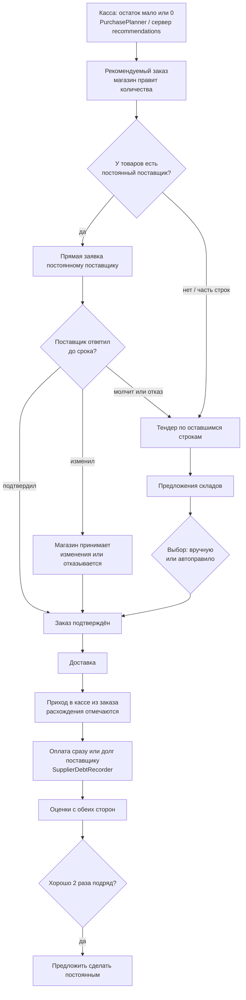
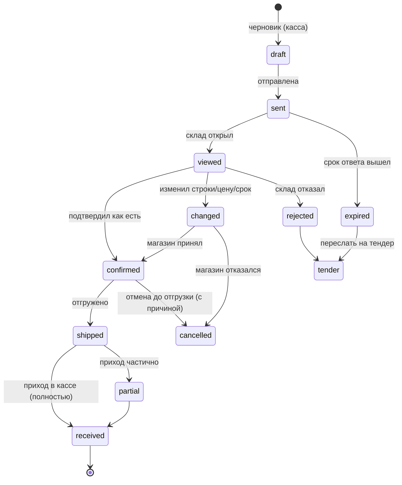
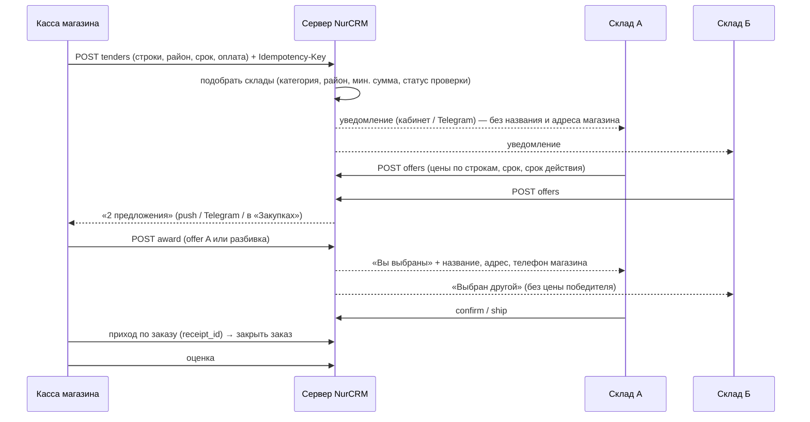
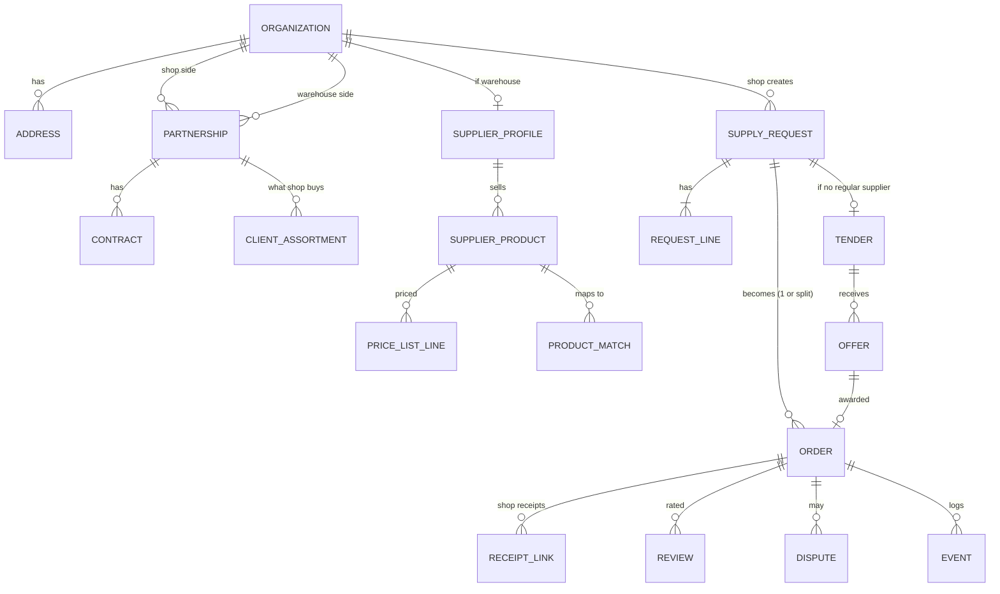

# Концепция и ТЗ MVP: Биржа поставщиков и ERP склада (05.11.2026)

**Для кого:** владелец NurCRM; разделы 5 и 7 — ещё и для Умара (сервер NurCRM).
**Статус:** концепция. Код не менялся, ничего не публиковалось.
**Основа:** код кассы и программы владельца (раздел 6), поиск аналогов в интернете (раздел 2, ссылки в конце), прошлые ТЗ (`docs/ТЗ Склад — ревизия, приёмка, поставщик, Telegram-группа (24.10.2026).md`, `docs/Отчеты/ТЗ от Умара — функции маркетплейса с сервера (31.10.2026).md`).

---

## Резюме (коротко)

**Идея.** Единая база поставщиков для магазинов. Если товар кончается, магазин создаёт заявку. Есть постоянный поставщик — заявка уходит ему сразу. Нет — устраивается «тендер», как в Яндекс Такси: подходящие склады предлагают цену и срок, магазин выбирает. Потом склад получает своё ERP: магазин в нём — клиент с адресом, договором и списком товаров. Ещё позже то же самое для кафе.

**Наше главное преимущество.** Касса уже знает остатки и продажи. Поэтому заявку не нужно набирать руками: её готовит «Рекомендуемый заказ» (`PurchasePlanner`). У площадок Supl.biz и OptomPro такого нет: там покупатель пишет заявку сам.

**Главный вывод.** Не надо начинать с тендера. Сначала нужна **модель Choco**: магазин отправляет заказ **своим** поставщикам из кассы, а поставщик открывает его по ссылке, без регистрации. Магазину это полезно с первого дня, даже если на бирже ещё нет ни одного склада. А каждый заказ по ссылке приводит в NurCRM нового склада. Тендер включаем только там, где уже набралось достаточно складов, например от 5 активных в категории и районе. ERP склада по сути и есть NurCRM: «Клиенты», «Долги» и накладные клиентам уже есть. Не хватает входящих заказов, договоров и прайс-листов.

**Главные риски.**
1. Холодный старт складов. Без складов тендер пустой, а магазины не вернутся.
2. Основной товар (напитки, табак, бренды) возят дистрибьюторы с закреплёнными брендами. Там тендер не нужен, их нужно подключать как постоянных поставщиков.
3. Оптом торгуют с отсрочкой и в долг. Чужой кредитный риск брать нельзя: на нём обожглись Udaan, Wasoko и Marketforce.
4. Нужен межкомпанейский доступ на сервере Умара. Сейчас компании NurCRM полностью изолированы друг от друга.
5. Юридическая часть. Платформа — только посредник, договор и ЭСФ остаются между магазином и складом. Персональные данные — только с согласия.

**Этап 0 (без сервера Умара, 3–5 недель).** Добавить «Спросить цены у других поставщиков» через WhatsApp из «Рекомендуемого заказа» и проверить спрос «консьерж-тендером» вручную. Если сработает — сделать бот-биржу на нашем сервере ботов (как NurSupportBot).

**Первые 2 недели.** Поговорить с 10 магазинами и 10 складами, посчитать по данным NurCRM, сколько у магазинов поставщиков и как часто они закупают, провести вручную «консьерж-тендер» на 5 магазинах и согласовать с Умаром модель «партнёрства компаний». Подробнее в разделе 10.

---

## 1. Идея: что в ней сильное и что слабое

### 1.1. Сильные стороны

| Что | Почему это важно |
|---|---|
| Заявка появляется сама из остатков и продаж | «Рекомендуемый заказ» в кассе уже есть. Магазину не нужно ничего набирать, а у других площадок покупатель пишет заявку сам |
| Магазины уже в NurCRM | Спрос привлекать не нужно: покупатели уже наши клиенты. Остаётся привести склады |
| Приход, долг поставщику и возврат уже есть | После выбора поставщика цепочка «заказ → приход → оплата или долг» замыкается в одной программе |
| Склад тоже может работать в NurCRM | «Клиенты», «Долги» и накладные клиентам уже есть, ERP склада не нужно писать с нуля |
| Рынок Кыргызстана слабо оцифрован | Работающей платформы оптовых заказов для магазинов в КР не нашли. OptomPro пока на уровне плана (интервью 2024 г.) |

### 1.2. Слабые стороны и риски

**Холодный старт.** Площадке с двумя сторонами нужны обе сразу. Если на заявку магазина никто не ответит 2–3 раза, магазин уйдёт. Что делаем:
- (а) сначала прямые заказы своим поставщикам. Это полезно без единого склада на бирже: «один игрок» тоже получает пользу.
- (б) склад принимает заказ по ссылке, без регистрации. Так делает Choco: поставщик получает заказ в WhatsApp, по почте или в своём ERP.
- (в) тендер включаем по районам и категориям, только когда набралось достаточно складов.
- (г) первые тендеры ведёт вручную менеджер NBS («консьерж»).

**Доверие.** Магазин боится, что склад не привезёт или подменит товар. Склад боится, что магазин не заплатит или откажется от заказа. Что делаем: проверка склада по ИНН, рейтинги с обеих сторон по фактам (привёз вовремя, сумма совпала с приходом, оплата в срок), разбор споров, первые заказы — небольшие.

**Разные стороны рынка ведут себя по-разному.**

| Тип поставщика | Как продаёт сейчас | Нужен ли тендер |
|---|---|---|
| Дистрибьютор бренда (напитки, табак, бытовая химия) | Торговый агент приходит в магазин, цены по прайсу, бренд закреплён за дистрибьютором | Почти нет. Нужна прямая отправка и электронный прайс |
| Оптовик-универсал (бакалея, хозтовары, упаковка, оптовые базы) | WhatsApp, звонок, магазин едет сам | **Да**: товар взаимозаменяемый, цены разные |
| Овощи, фрукты, мясо, молочка от фермеров | Звонок утром, наличные | Да, но на короткие сроки (часы) и с весовым товаром |
| Производитель (хлеб, вода, полуфабрикаты) | Ежедневный маршрут, постоянные точки | Нет, нужен «повтор заказа» и график |

**Юридическая часть в Кыргызстане.** Это не юридическая консультация, перед стартом нужен юрист.
- Платформа — **информационный посредник**, а не сторона сделки. Договор поставки заключают магазин и склад. В пользовательском соглашении нужно прямо написать, что платформа не отвечает за качество, сроки и оплату.
- **ЭСФ.** По данным ГНС, с 1 мая 2023 г. ЭСФ оформляют все налогоплательщики, кроме патентщиков, работающих с ККМ, и плательщиков единого налога с выручкой до 8 млн сом. С 1 мая 2025 г. срок — не позднее 5 рабочих дней после поставки. ЭСФ выписывает продавец, то есть склад, а покупатель подтверждает. Платформа ЭСФ не выписывает. В ERP склада позже можно добавить «подготовить данные для ЭСФ».
- **ЭТТН** обязательна для алкоголя, табака и нефтепродуктов, с 2027 г. — для лекарств. На старте эти категории лучше вообще исключить из тендера.
- **Персональные данные.** Адрес, телефон и имя владельца магазина передаём складу только после выбора и с согласием в условиях. Заказ также подпадает под закон «Об информации персонального характера»: нужно проверить, надо ли регистрироваться держателем базы персональных данных.
- **Электронная торговля.** В закон вносились изменения, а в 2026 г. узаконили электронные векселя. Это может пригодиться для отсрочки, но статус нужно проверить у юриста.
- **Деньги.** Платежи между магазином и складом через платформу на старте **не проводим**: иначе платформа становится платёжным агентом с лицензией и ответственностью. Платежи идут напрямую, платформа только фиксирует их.

**Оплата и долги.** Опт в регионе держится на отсрочке. Уроки Udaan, Wasoko и MaxAB: кредит магазинам — главный рычаг роста и главный источник убытков (просрочка 5–15 % по слабым источникам). Udaan в 2026 г. сократил FMCG-направление. **Правило для нас:** отсрочку даёт склад на свой риск. Платформа показывает складу историю оплат магазина, только если магазин согласен. Своих денег в кредит не даём. Партнёрство с банком — не раньше этапа 3.

**Конкуренция.**

| Кто | Чем опасен |
|---|---|
| WhatsApp, звонок, торговый агент | Привычка. Мы не заменяем WhatsApp, а пишем в него (как Choco) |
| Smartup24 (Узбекистан) | B2B-площадка «магазин сравнивает дистрибьюторов», есть интеграции с 1С, SAP, SalesDoctor и кассами. Ближайший аналог, может прийти в КР |
| Kaspi Pay «Оптовые покупки» (Казахстан) | Сильная экосистема, но для Казахстана; есть оптовые закупки из Китая |
| OptomPro (КР) | Оптово-розничная площадка, в 2024 г. была на уровне плана, искала финансирование |
| Ozon «для бизнеса», Яндекс Маркет | Розничные площадки с режимом для юрлиц, не про ежедневное пополнение магазина у дома |
| МойСклад, iiko, Poster | Закупки внутри своей программы, без общей базы поставщиков |

---

## 2. Аналоги: что взять и чего избегать

| Аналог | Модель (кратко) | Что берём | Чего избегаем |
|---|---|---|---|
| **Choco** (Германия, рестораны) | Бесплатно для ресторана, заказ уходит поставщику в удобном ему виде: почта, WhatsApp, SMS, ERP. Поставщик может не регистрироваться. Платит поставщик (тариф по запросу, «Premium»: ERP, подключение клиентов). В 2025 г. запустил ИИ-агента «Autopilot» для приёма заказов | **Главный образец.** Заказ своим поставщикам с первого дня, склад без регистрации, магазину бесплатно, платит склад | Поставщики могут не захотеть платить за «чужие» заказы: начинаем с пользы, тариф вводим позже |
| **Faire** (США, опт для магазинов) | Комиссия с бренда (по разным источникам 15–25 % с первого заказа, 0 % с заказов клиентов, которых бренд привёл сам — «Faire Direct»). Магазину отсрочка 60 дней, кредитный риск на Faire | Нет комиссии со «своих» клиентов. Рейтинг магазина по истории оплат | Отсрочка за счёт платформы: нам не по силам и опасно |
| **Handshake** (Shopify) | Портал оптовых заказов, Shopify купил его в 2019 г., потом переделал и закрыл старый продукт (даты в источниках расходятся) | Урок: просто «портал заказа» без сети — слабый продукт | Строить только витрину без сети поставщиков |
| **Pepper** (США, пищевые дистрибьюторы) | Своё приложение с логотипом дистрибьютора для заказов клиентов + оплаты, подключение ERP за 3 недели | Для ERP склада: «приложение склада для своих клиентов», история заказов, оплата | Цифры роста в пресс-релизах — маркетинг |
| **Supl.biz** (Россия) | Покупатель бесплатно размещает заявку, поставщики рубрики присылают цены. Поставщик платит подписку (от часа до года) за доступ к заявкам | Ближайший «тендер». Подписка склада за доступ к заявкам | Заявки набираются вручную и бывают «мусорными». У нас заявка из кассы, это и есть отличие |
| **ERPNext — запрос цен** (открытый код) | Один запрос — много поставщиков, у каждого своё предложение, отчёт-сравнение; ответ поставщика сначала черновик | Модель данных «Заявка → Предложения → Сравнение», ответ из кабинета поставщика | Сложный интерфейс для магазина у дома |
| **Тендерные площадки** (Zakupka, B2B-Center, Fabrikant, госзакупки КР) | Формальные торги, сроки в днях, документы | Закрытые цены (участник не видит чужие), срок приёма ответов, протокол выбора | Бюрократия. Нам нужна скорость «как такси»: минуты и часы |
| **Kaspi Pay «Оптовые покупки»** (Казахстан) | Партнёр выбирает товары, поставщик подтверждает за 2 рабочих дня, оплату вносит руководитель. Доступно не всем | Шаг «поставщик подтвердил», подтверждение суммы руководителем | — |
| **Ozon для бизнеса / Яндекс Маркет** | Розничная площадка + покупки юрлицом, закрывающие документы от площадки. По Яндексу данных мало | Закрывающие документы — в далёком будущем | Не конкурируем на их поле (каталог для всех) |
| **МойСклад** | Автозаказ поставщикам — платное приложение. Закупка под заказы с учётом остатков | Подтверждает спрос на автозаказ, он у нас уже есть | — |
| **iiko / Poster** (кафе) | Заказ поставщику внутри программы. Документацию поиск не нашёл, нужна проверка | Для кафе: расход по техкартам → заказ | — |
| **Smartup24** (Узбекистан) | Магазин сравнивает предложения дистрибьюторов, дистрибьюторы получают новые точки, интеграции с 1С, SAP, SalesDoctor, POS | Прямой ориентир: сравнение цен, статусы доставки | Узнать их условия до старта (вопрос 9.1) |
| **OptomPro, Made in KG, BazarMarket** (КР и Дордой) | OptomPro — план (2024). Made in KG — экспорт одежды, подписка 19 990 сом в год. BazarMarket — оцифровка Дордоя (по Astana Hub) | Порядок цен: подписка поставщика ~1,5–2 тыс. сом в месяц воспринимается нормально | Экспорт и одежда — не наш рынок |
| **Wasoko + MaxAB, Udaan, Marketforce** (Африка, Индия) | Свои склады + доставка + кредит лавкам. Слияние, сокращение рынков, закрытия | Кредит — главный рычаг, но только на данных платформы | Свой склад, своя логистика, свои деньги в кредит |

**Итог: что берём.**
1. Заказ своим поставщикам бесплатно для магазина, склад без регистрации (Choco).
2. Нет комиссии с прямых заказов «своих» (Faire Direct), платят только за новых клиентов из тендера.
3. «Заявка → предложения → сравнение» с закрытыми ценами (ERPNext, тендеры).
4. Подписка склада за доступ к заявкам (Supl.biz).
5. Подтверждение поставщиком в срок (Kaspi).

**Итог: чего избегаем.**
1. Свои склады, логистика, деньги в кредит.
2. Провести платежи через себя на старте.
3. Тендер там, где рынок закреплён за дистрибьюторами.
4. Заявки «вручную от руки», без данных кассы.

---

## 3. Роли и пользовательские истории

### 3.1. Роли

| Роль | Кто это | Где работает |
|---|---|---|
| Магазин: владелец | Решает, у кого брать, подтверждает крупные заказы | Программа владельца, мобилка, Telegram |
| Магазин: закупщик или старший кассир | Собирает заявку, принимает товар | Касса → «Закупки», мобилка |
| Склад: владелец или менеджер | Отвечает на заявки, назначает цену и срок, ведёт клиентов | Кабинет склада (веб или программа владельца NurCRM), Telegram, ссылка из WhatsApp |
| Склад: кладовщик или экспедитор | Собирает и отвозит | Мобилка (лист сборки, маршрут) |
| Платформа (NBS) | Проверка складов, споры, тарифы, справочник категорий | Админка платформы |
| Кафе (позже) | Как магазин, но ингредиенты и ежедневные поставки | То же + техкарты |

### 3.2. Пользовательские истории (MVP отмечен этапом)

| № | Как… | хочу… | чтобы… | Этап |
|---|---|---|---|---|
| М-1 | владелец магазина | одной кнопкой отправить «Рекомендуемый заказ» постоянному поставщику | не переписывать список в WhatsApp | 0–1 |
| М-2 | владелец магазина | видеть статус: отправлен, просмотрен, подтверждён, изменён, в пути, принят | не звонить «ну что там» | 1 |
| М-3 | закупщик | при приходе товара открыть приход уже заполненным из подтверждённого заказа | не вбивать всё второй раз | 1 |
| М-4 | владелец | если поставщик изменил количество или цену, подтвердить это или отказаться | не получить сюрприз при приёмке | 1 |
| М-5 | владелец | при отсутствии постоянного поставщика (или если он не ответил) отправить заявку на тендер | быстро найти, у кого есть | 2 |
| М-6 | владелец | сравнить предложения (цена, срок, рейтинг, покрытие) и выбрать, в том числе разбить по поставщикам | купить выгоднее | 2 |
| М-7 | владелец | включить автовыбор с лимитом суммы | не сидеть у телефона | 2 |
| М-8 | владелец | повторять заказ по расписанию («каждый понедельник») | не забывать | 1–2 |
| М-9 | владелец | оценить поставщика после приёмки | чтобы рейтинг был честным | 2 |
| С-1 | склад | получить заказ в WhatsApp или Telegram со ссылкой и подтвердить его без регистрации | начать работать за 1 минуту | 1 |
| С-2 | склад | указать категории, районы доставки, минимальную сумму, условия оплаты | получать только свои заявки | 2 |
| С-3 | склад | ответить на тендер ценой и сроком по строкам, в том числе частично | выиграть заказ | 2 |
| С-4 | склад | загрузить прайс-лист (Excel) и сопоставить товары | отвечать на заявки автоматически | 2–3 |
| С-5 | склад | вести магазин как клиента: адреса точек, договор, отсрочка, лимит долга, список товаров | учёт, как в ERP | 3 |
| С-6 | склад | видеть долг магазина и акт сверки | получать деньги вовремя | 3 |
| П-1 | платформа | проверить склад по ИНН и телефону до допуска к тендерам | отсечь мошенников | 2 |
| П-2 | платформа | разобрать спор по фактам (заказ, подтверждение, приход, фото) | доверие | 2 |
| К-1 | кафе | получать заказ по расходу из техкарт, доставка до 9:00 | свежие продукты каждый день | 4 |

---

## 4. Сценарии

### 4.1. Общая схема



### 4.2. Прямая заявка постоянному поставщику

1. Магазин открывает «Закупки → Рекомендуемый заказ» по поставщику, правит количества и нажимает «Отправить». Сейчас эта кнопка открывает WhatsApp (см. раздел 6).
2. Заявка уходит одним из способов:
   - склад зарегистрирован в NurCRM — во входящие кабинета склада и уведомлением в Telegram;
   - склад не зарегистрирован — сообщением в WhatsApp со ссылкой `https://app.nurcrm.kg/o/<токен>`, по которой можно открыть, подтвердить или изменить заказ без входа.
3. Склад отвечает построчно: «есть / есть N / нет / замена на …», цена, дата доставки.
4. Если ответ отличается от заявки, магазин видит различия (красным), принимает или отменяет.
5. Срок ответа по умолчанию — 2 часа в рабочее время. Не ответил — напоминание, затем предложение «отправить на тендер».

**Статусы заявки:**



### 4.3. Тендер (когда постоянного поставщика нет)

**Параметры тендера:**

| Параметр | Варианты | По умолчанию |
|---|---|---|
| Строки | Из рекомендуемого заказа или вручную, товар, штрихкод, единица, количество | — |
| Категория | Из справочника платформы (молочка, бакалея, овощи, хозтовары, упаковка…), определяется по товарам | авто |
| Регион | Район или город + радиус от адреса магазина (км) | город магазина, 15 км |
| Срок ответа | 30 мин / 2 ч / до 18:00 / до завтра 10:00 | 2 ч |
| Нужно к | Дата и окно доставки | завтра |
| Самовывоз | Да/нет (магазин заберёт сам) | нет |
| Оплата | Наличные при получении / перевод / отсрочка N дней | наличные |
| Минимум | Сколько предложений ждать до автовыбора | 2 |
| Кому | Все подходящие / только проверенные / не больше N складов | проверенные, до 10 |
| Частичные предложения | Можно ли предлагать часть строк | да |
| Замены | Разрешены ли аналоги | спросить |
| Правило выбора | Вручную / автоправило | вручную |
| Видимость | Склады не видят чужих цен (закрытый тендер) | закрыто всегда |

**Правила автовыбора (по выбору магазина):**
- «Самая низкая сумма», среди предложений с рейтингом склада не ниже X и покрытием строк не меньше Y %.
- «Самый быстрый», при цене не выше лучшей больше чем на Z %.
- «Баланс»: балл = 0,5 × цена + 0,3 × срок + 0,2 × рейтинг (каждое приведено к 0…1), минус штраф за непокрытые строки.
- **Ограничители:** автовыбор только если сумма не больше лимита магазина (например, 20 000 сом) и пришло не меньше «минимума» предложений. Иначе — уведомление «выберите сами».
- **Разбивка:** магазин может взять строки 1–5 у склада А, а 6–9 у склада Б. Выйдет два заказа.

**Если что-то пошло не так:**

| Ситуация | Что делает система |
|---|---|
| Никто не ответил | Предложить расширить радиус, продлить срок или разрешить замены, а владельцу NBS — сигнал «пустой район» (для продаж складам) |
| Победитель не подтвердил в течение 30 мин | Предложить второе место без нового тендера |
| Победитель не привёз или привёз не то | Спор, минус рейтинг, второе место |
| При отгрузке цена изменилась | Это изменение по шагу 4.2.4: магазин подтверждает |
| Магазин выбрал и отменил | Минус рейтинг магазина, склад видит частоту отмен |

**Повтор заказа:** «Повторить прошлый заказ», «Каждый понедельник в 9:00 отправлять рекомендуемый заказ поставщику Х на подтверждение». После двух удачных заказов у победителя тендера — «Сделать постоянным поставщиком для этих товаров?».



---

## 5. Модель данных и приватность

### 5.1. Сущности

Главная новая идея — **межкомпанейская связь (партнёрство)**: компания-магазин и компания-склад в NurCRM связываются записью, а не общим доступом. Сейчас у магазина поставщик — это запись `clients` с `type=suppliers` внутри его компании (`SupplierApiService`). У склада магазин станет записью `clients` с `type=clients` внутри компании склада. Партнёрство склеивает эти две записи.

| Сущность | Ключевые поля | Где живёт |
|---|---|---|
| **Организация** (компания NurCRM) | id, вид (магазин / склад / кафе / смешанный), название, ИНН, телефон, город, статус проверки | сервер (уже есть компания + новое поле «вид») |
| **Профиль склада** (для биржи) | компания, категории[], зоны доставки (районы, радиус от точки), мин. сумма, дни и окна доставки, оплата (нал / перевод / отсрочка до N дней), самовывоз, фото и описание, проверен (ИНН, дата), тариф | сервер |
| **Адрес / точка** | организация, название точки, адрес, координаты, телефон точки, часы приёма товара | сервер |
| **Партнёрство** | магазин_id, склад_id, запись поставщика у магазина (clients.id), запись клиента у склада (clients.id), статус (приглашён / активен / приостановлен), кто пригласил, дата | сервер |
| **Договор** | партнёрство, номер, дата, срок, отсрочка дней, лимит долга, тип цен / прайс, скидка %, файл (PDF), кто видит | сервер (у склада), копия у магазина |
| **Товар поставщика** | склад, артикул склада, название, штрихкод(ы), единица, кратность (упаковка), цена, остаток (по желанию), категория | сервер (прайс склада) |
| **Сопоставление** | магазин, склад, товар поставщика ↔ товар магазина, источник (штрихкод / память / ИИ / вручную), уверенность, кто подтвердил | сервер (сейчас похожая память — на ПК: `InvoiceMatchMemory`) |
| **Прайс-лист** | склад, название, тип цен (опт / крупный опт / для договора), действует с–по, строки (товар поставщика, цена, мин. кол-во) | сервер |
| **Список товаров клиента** («матрица») | партнёрство, товар поставщика, обычное количество, периодичность | сервер (у склада) |
| **Заявка** (`supply_request`) | номер, магазин, точка, режим (прямая / тендер), склад (для прямой), статус, строки, нужно к, оплата, комментарий, источник (рекомендуемый заказ / вручную / повтор), ключ повтора, автор, версия | сервер (сейчас на ПК: `PurchaseOrder` в `PurchasesStore`) |
| **Строка заявки** | товар магазина, товар поставщика (если сопоставлен), название / штрихкод / единица, кол-во, последняя цена закупки, разрешена замена | сервер |
| **Тендер** | заявка, категория, район / радиус, срок ответа, кому, правило выбора, лимит автовыбора, статус (открыт / закрыт / выбран / пустой) | сервер |
| **Предложение** | тендер, склад, строки (цена, доступное кол-во, замена), доставка к, действует до, оплата, комментарий, статус (подано / отозвано / выбрано / проиграло) | сервер |
| **Заказ** (после выбора или подтверждения) | заявка, склад, итоговые строки, сумма, статус отгрузки, ссылки на приходы магазина (`suppliers/receipts`), на отгрузку склада | сервер |
| **Событие** | объект, тип, кто, когда, что изменилось | сервер (журнал для споров) |
| **Оценка** | заказ, кто оценивает, кого, оценки (вовремя, комплектность, качество, оплата в срок), текст | сервер |
| **Спор** | заказ, кто открыл, причина, фото, статус, решение | сервер |
| **Отгрузка** (этап 3) | заказ, склад, маршрут, экспедитор, накладная, фото подписи, время | сервер |



### 5.2. Сопоставление «товар поставщика ↔ товар магазина»

Это самая трудная часть. Без неё не будет ни автоответа склада по прайсу, ни прихода из заказа. Порядок:
1. **Штрихкод** (у брендов почти всегда совпадает): точное совпадение.
2. **Память партнёрства**: «у этого склада это называется так». Сейчас то же самое делает касса для накладных, но только на ПК (`InvoiceMatchMemory`, ключ поставщика + нормализованное название). Нужно перенести на сервер: тогда помнят все кассы магазина, а склад видит, что магазин сопоставил.
3. **Нечёткий поиск**: сокращения, «1л» = «1000 мл», латиница и кириллица (уже есть в разборе накладных `InvoicePlan`).
4. **ИИ по кнопке** и только с подтверждением человека (как «Подобрать ИИ» в накладных).
5. Несопоставленные строки отправляются текстом: склад видит название и штрихкод магазина и сам выбирает свой товар. Это сопоставление запоминается.

### 5.3. Приватность: кто что видит

| Данные | Склад до выбора (тендер) | Склад после выбора / постоянный | Другие склады-участники | Платформа (NBS) |
|---|---|---|---|---|
| Состав заявки (товары, количества) | да | да | да (каждый — только свою копию) | да |
| Название магазина | **нет** — «Магазин в Свердловском районе» | да | нет | да |
| Точный адрес и телефон | **нет**, только район и расстояние «~3 км» | да | нет | да |
| Рейтинг магазина (оплата в срок, отмены) | обезличенно: «★4,6 · 23 заказа · 96 % вовремя» | да | — | да |
| Долг магазина этому складу | — | да (это их общий долг) | нет | только при споре |
| Долги магазина другим складам | нет | **нет** | нет | агрегат для рейтинга |
| Продажи и остатки магазина | **никогда** | **никогда** (только заявка) | никогда | нет (кроме обезличенной статистики, если разрешено соглашением) |
| Договор | — | только две стороны | нет | только при споре, с записью в журнал |
| Цены других предложений | **нет** (закрытый тендер) | нет | нет | да |
| Место в тендере | «Выбран / не выбран» (без цены победителя) | — | — | да |
| Название склада и его цена | магазин видит все предложения с названиями и рейтингами | — | — | да |

Ещё три правила:
- Каждый просмотр договора или данных магазина работником платформы пишется в журнал.
- Магазин может скрыть себя от тендеров: включить «только прямые заказы».
- Склад, который трижды выиграл и не привёз, на 30 дней теряет доступ к тендерам.

---

## 6. Как это ложится на то, что уже есть

### 6.1. Что уже есть и как это используем

| Что уже есть | Где в коде | Как используем |
|---|---|---|
| Расчёт рекомендуемого заказа (продажи в день × (запас + страховой) − остаток) | `NurMarketKassa.Infrastructure/Services/Purchases/PurchasePlanner.cs`; сервер `GET api/main/suppliers/{id}/recommendations/` — `SupplierApiService.cs:359` | **Источник заявки.** Строки, количества, статусы «кончится через N дней», «нет в наличии» |
| Экран «Рекомендуемый заказ» | `NurMarketKassa.Avalonia/Views.axaml/Main/PurchasesWindow.Recommend.cs` (отправка в WhatsApp — строка 665) | Добавить кнопки «Отправить через NurCRM» и «Найти поставщика (тендер)» рядом с WhatsApp |
| Заказ поставщику (черновик / отправлен / частично / принят / отменён), связь с приходами (`ReceiptIds`, `ReceivedQty`) | `NurMarketKassa.Infrastructure/Services/Purchases/PurchasesStore.cs` — `PurchaseOrder`, `PurchaseOrderLine` | Модель заявки уже есть, но **только в файле на ПК** (`%APPDATA%\NurMarketKassa\purchases\purchases.json`). На этапе 1 её место занимает серверная заявка, локальный журнал остаётся запасным |
| Окно заказа поставщику (PDF, печать, WhatsApp) | `Views.axaml/Main/PurchaseDialogs.cs:566` (`PurchaseOrderDialog`, WhatsApp — 619) | Здесь появятся статус ответа склада и изменения |
| Текст заказа и отправка в WhatsApp | `NurMarketKassa.Avalonia/Services/PurchaseDocs.cs` (`OrderText`, `OpenWhatsApp` с номерами 996…) | Этап 0: тот же текст + ссылка на заказ и машиночитаемая строка для бота |
| «Пополнение и сроки» | `Views.axaml/Main/RestockSuggestionsWindow.axaml.cs` (`BuildOrderText`, 275) | Второй вход в заявку (по всем поставщикам сразу) |
| Поставщики: список, карточка, реквизиты (ИНН, ОКПО, р/с, БИК, адрес), сводка долга | `NurMarketKassa.Infrastructure/Services/Api/SupplierApiService.cs` (`clients/?type=suppliers`, `clients/{id}/kpis/`, `deals`); окна `SuppliersWindow.cs`, `SupplierCardView.cs`, `SupplierEditDialog.cs`, `Dialogs/SupplierQuickCreate.cs` | Запись поставщика у магазина = сторона «Партнёрства». В карточку — «Пригласить в NurCRM», «Постоянный для категорий…» |
| Товары поставщика у магазина | `GET suppliers/{id}/products/` (`SupplierProduct`) | Начальный список «что магазин берёт у этого склада» для склада |
| Приход по накладной, фоновая очередь приёмки, разбор накладных по фото и Excel, память сопоставлений | `PurchaseReceivingService.cs`, `BackgroundReceivingQueue*.cs`, `InvoiceImport/InvoicePlan.cs`, `InvoiceImport/InvoiceMatchMemory.cs`, `Dialogs/InvoiceImportWindow.cs` | «Приход из заказа» с заполненными строками. Память сопоставлений → серверное «Сопоставление» (5.2) |
| Долг поставщику после прихода «в долг» (сделка `kind=debt`, метка `receipt:<id>`, очередь «долг не записан») | `NurMarketKassa.Infrastructure/Services/SupplierDebtRecorder.cs`, `Services/PurchasePaymentService.cs`, `Services/SupplierDebtUi.cs` | Без изменений: оплата сразу или долг. На этапе 3 склад видит **тот же** долг со своей стороны |
| Возвраты поставщику и накладная возврата | `SupplierReturnsWindow.cs`, `SupplierReturnDocuments.cs` | Спор «привёз не то» → возврат со ссылкой на заказ |
| Ключи повтора (Idempotency-Key) для денежных и складских POST; маркеры `supplier`, `purchase`, `invoice` уже в списке | `NurMarketKassa.Infrastructure/Services/Api/MoneyRequestKeys.cs`; явный ключ при создании поставщика — `SupplierApiService.CreateAsync` | Все новые POST (заявка, предложение, выбор, подтверждение, отгрузка) — **с ключом повтора**. Повтор после обрыва не создаёт второй заказ |
| Признаки возможностей сервера и купленные функции | `ServerCapabilities.cs` (`GET main/capabilities/`), `GET users/company/addons/` (в веб-админке уже есть код `procurement`) | Включение биржи по признаку `supply_exchange` или функции `procurement`. Без признака касса работает как сейчас |
| Общие настройки компании в облаке | `SettingsCloudSync.cs` (`api/main/app-settings/{app}/`), пример — `ClientDocsStore.cs` | Этап 0: список «запасных поставщиков по категориям» компании без нового API |
| Telegram-бот владельца в кассе и «Группа заказов» | `TelegramBotService.cs`, `TelegramBotOwner.Group.cs`, `TelegramBotPollingService*.cs` | Уведомления «склад ответил», «есть предложения» |
| Бот на сервере NurCRM (вебхук, отвечает при выключенной кассе) | `Api/ServerTelegramBotApi.cs` (`api/main/telegram-bot/…`) | Этап 1+: уведомления складу и магазину с сервера |
| Общий бот NBS на своём сервере (вход логином NurCRM, SQLite, админка) | `NurSupportBot/` (README) | **Этап 0, вариант Б**: бот-биржа по тому же образцу |
| Перемещения между филиалами (документ между двумя складами с подтверждением) | `StockTransferService.cs`, `Dialogs/StockTransferDialog.Branches.cs` | Образец документа «отправил — подтвердил — принял» с ключом повтора |
| Клиенты, долги клиентов, накладные клиентам | `ClientDebtsApiService.cs`, `DebtsWindow.cs`, `ClientDocEditorWindow.cs`, `DebtReminderWindow.cs` (напоминания в WhatsApp по очереди) | **ERP склада (этап 3)**: склад, работающий в NurCRM, ведёт магазины как клиентов. Рассылка по очереди → образец для этапа 0 |
| Заказы с витрины market.nurcrm.kg | `ShowcaseApiService.cs`, `SiteOrdersWindow.axaml.cs` | Образец «входящих заказов» и уведомлений для кабинета склада |
| Мобилка | `NurMarketMobile/` (партии товаров с поставщиком — `features/stock/product_batches.dart`) | Мобильная заявка и приход из заказа; этап 3 — «торговый агент склада» |

### 6.2. Чего не хватает (по коду)

1. Заказ поставщику не хранится на сервере: журнал `PurchasesStore` лежит на ПК, сервер про заказы не знает. В комментарии прямо сказано: «у сервера NurCRM нет заказа поставщику».
2. Нет связи между компаниями: поставщик для магазина — просто карточка с телефоном.
3. Нет каталога и прайса склада. «Товары поставщика» — это товары **магазина** с полем `client` = поставщик.
4. Нет справочника категорий и районов, общего для всех компаний.
5. Нет уведомлений «другой компании» (склад не в NurCRM).

---

## 7. Этапы

Оценки трудоёмкости грубые: недели одного разработчика, без учёта проверки и выпуска. Их нужно уточнить с Умаром.

### Этап 0. Без сервера Умара: проверка спроса (3–5 недель)

**Цель:** понять, будут ли магазины просить цены у новых складов и ответят ли склады, не трогая сервер NurCRM.

**Вариант А — WhatsApp из кассы (минимум, 1–1,5 недели).**
- Касса и программа владельца:
  - в настройках компании (`app-settings/nurmarket-kassa`, новый ключ `supplierExchange`) хранится список «запасных поставщиков» (имя, телефон, категории, район), общий для всех касс компании. Заполняет владелец, а NBS может дать стартовый список по городу;
  - в «Рекомендуемом заказе» появляется кнопка «Спросить цены у других (N)». Она по очереди открывает WhatsApp с готовым текстом (`PurchaseDocs.OrderText` + «Пришлите цену и срок до 16:00»), «следующий» — как в `DebtReminderWindow`;
  - ответы магазин вносит сам: «Цена/срок от поставщика», таблица сравнения, «Выбрать». Выбор становится обычным `PurchaseOrder`, дальше всё как сейчас;
  - журнал «кого спросили, кто ответил, кого выбрали» хранится локально и попадает в общий счётчик для метрик.
- Сервер: ничего.
- Риски: ручной ввод ответов, WhatsApp не даёт массовую рассылку без Business API (поэтому по одному), общей базы складов нет.

**Вариант Б — бот-биржа на сервере ботов NBS (2–3 недели после А, по решению владельца).**
- Отдельный бот (`@NurCRM_Birzha` или раздел в NurSupportBot), тот же стек, что `NurSupportBot`: .NET, SQLite, long polling, вход логином NurCRM.
- Склад регистрируется в боте: название, ИНН, телефон, категории, районы, минимальная сумма. Модератор NBS подтверждает.
- Магазин в кассе нажимает «Отправить на биржу». Касса открывает бота по ссылке `t.me/<бот>?start=<короткий код>`, а текст заявки с машиночитаемой строкой (`#З-2026-0012 | кат: бакалея | район: Свердловский | до: 16:00`) магазин пересылает боту одним нажатием. **Токен бота в кассе не храним**: иначе любой мог бы им злоупотребить.
- Бот рассылает заявку подходящим складам (без названия и адреса магазина) с кнопкой «Предложить цену» → короткая форма: сумма, срок, комментарий, файл КП.
- Магазин получает предложения в боте и нажимает «Выбрать». Бот обменивает контакты победителя и магазина и сообщает остальным «выбран другой».
- В кассе — «Внести выбор из биржи» (вводится код или вставляется текст), дальше обычный заказ и приход.
- Риски: это **наш** сервер. Правило «своего сервера нет» касается кассы, но решение за владельцем (вопрос 9.1). Ещё риски: данные магазинов в нашей SQLite (согласие, резервные копии), модерация вручную.

**Метрики успеха этапа 0 (за 4 недели):**
- 20 магазинов отправили хотя бы 3 запроса цен;
- не меньше 50 % запросов получили 2 и больше ответа в течение 2 часов;
- не меньше 30 % запросов закончились покупкой;
- 30 складов согласились получать заявки (вариант Б);
- 5 магазинов сами просят «сделать постоянным».

**Если метрики не набраны:** тендер откладываем, делаем только прямые заказы (этап 1). Они полезны в любом случае.

### Этап 1. Заявки и ответы в кабинете склада (нужен сервер Умара)

**Цель:** прямые заказы постоянным поставщикам через NurCRM со статусами и приходом из заказа. Склад работает по ссылке без регистрации или в кабинете.

**Касса и мобилка (3–4 недели):**
- «Отправить через NurCRM» в «Рекомендуемом заказе» и в окне заказа; статусы и изменения склада в «Закупках»; подтверждение изменений.
- «Приход из заказа»: строки из подтверждённого заказа, расхождения подсвечиваются; связь `order_id ↔ receipt_id`.
- Перенос `PurchaseOrder` на сервер с локальной копией. Если сервер не поддерживает функцию (нет признака) — всё как сейчас.
- Карточка поставщика: «Пригласить в NurCRM» (ссылка или код) и статус партнёрства.
- Уведомления: Telegram-бот владельца, значок в «Закупках», push в мобилке.
- Все надписи на 5 языках.

**Сервер (Умар, 4–6 недель) — эскиз API:**

```
# Партнёрство (межкомпанейская связь)
POST /api/procurement/partners/invite/        {supplier_client_id, phone|inn}        → {invite_code, link}
POST /api/procurement/partners/accept/        {invite_code}  (со стороны склада)     → {partnership_id}
GET  /api/procurement/partners/?side=shop|warehouse
PATCH /api/procurement/partners/{id}/         {status: active|paused}

# Заявка магазина (Idempotency-Key обязателен)
POST /api/procurement/requests/               {mode: direct, partnership_id | supplier_client_id,
                                               point_id, need_by, payment: cash|transfer|deferred,
                                               deferred_days?, note, source: planner|manual|repeat,
                                               lines:[{product_id, name, barcode, unit, qty,
                                                       last_price, supplier_sku?, allow_substitute}]}
GET  /api/procurement/requests/?status=&supplier=&from=&to=
GET  /api/procurement/requests/{id}/                (+ ETag, version)
POST /api/procurement/requests/{id}/send/
POST /api/procurement/requests/{id}/accept-changes/ {version}
POST /api/procurement/requests/{id}/cancel/         {reason}
POST /api/procurement/requests/{id}/receipts/       {receipt_id}  → пересчёт received_qty
GET  /api/procurement/requests/{id}/events/

# Входящие склада (кабинет)
GET  /api/procurement/inbox/?status=
POST /api/procurement/inbox/{id}/view/
POST /api/procurement/inbox/{id}/confirm/      {version, ship_at,
                                               lines:[{line_id, qty, price, substitute_sku?, note}]}
POST /api/procurement/inbox/{id}/reject/       {reason}
POST /api/procurement/inbox/{id}/ship/         {doc_number?, eta}

# Ссылка без регистрации (склад не в NurCRM)
GET  /o/{token}                                — страница заказа (токен одноразовый на заказ, срок 14 дней)
POST /o/{token}/confirm | /reject              — те же поля; телефон склада подтверждается кодом из SMS/WhatsApp
```

- **События:** `request.sent`, `request.viewed`, `request.confirmed`, `request.changed`, `request.rejected`, `request.expired`, `request.shipped`, `request.received`, `request.cancelled`. Доставка: Telegram (серверный бот), push, опрос с ETag. Для склада без регистрации — сообщение в WhatsApp со ссылкой: на старте отправляет сам магазин через wa.me, позже — WhatsApp Business API.
- **Права:** у магазина создаёт черновик кассир, отправляет владелец или администратор (настройка «кассир может отправлять до N сом»). У склада отвечают владелец и менеджер. Платформа читает только при споре, с журналом.
- **Версии:** у каждой заявки `version`, подтверждение и принятие изменений передают версию. Если версия устарела, сервер отвечает 409, и касса перечитывает заявку (как PATCH прихода с `If-Match`).
- **Признак:** `supply_requests` в `main/capabilities/`.

**Веб-кабинет склада (3–4 недели):** «Входящие», карточка заказа с построчным подтверждением, «Мои магазины» (партнёрства), настройки уведомлений.

**Риски:**
- Сервер должен впервые дать доступ «между компаниями». Нужна аудиторская проверка прав.
- Склады могут не открывать ссылку. Тогда нужен звонок от менеджера NBS на старте.
- Двойные заявки при обрыве связи: закрываются ключом повтора и версией.

**Метрики (через 2 месяца):**
- 30 % магазинов, у которых есть «Закупки», отправили хотя бы один заказ через NurCRM;
- 50 % заказов подтверждены складом по ссылке или в кабинете;
- 40 % приходов создаются «из заказа»;
- 15 складов перешли от ссылки к кабинету.

### Этап 2. Тендер и рейтинги

**Касса и мобилка (3–4 недели):** «Найти поставщика» в рекомендуемом заказе и при отказе или молчании постоянного; параметры (4.3); сравнение предложений (таблица: склад, рейтинг, сумма, покрытие, срок, оплата); разбивка; автоправило с лимитом; оценка после прихода; «Сделать постоянным».

**Сервер (5–8 недель) — эскиз API:**

```
# Профиль склада
PUT  /api/exchange/profile/                    {categories[], zones:[{district_id}|{lat,lng,radius_km}],
                                               min_order, delivery_days[], windows[], payment_terms[],
                                               pickup:bool, description}
POST /api/exchange/profile/verify/             {inn, documents[]}   → модерация NBS

# Тендер магазина
POST /api/exchange/tenders/                    {request_id, category?, district_id|radius_km,
                                               answer_deadline, need_by, payment, max_suppliers,
                                               only_verified, allow_partial, allow_substitute,
                                               selection: manual|auto,
                                               auto_rule?:{kind: cheapest|fastest|balanced,
                                                           max_total, min_rating, min_coverage, min_offers}}
GET  /api/exchange/tenders/{id}/offers/
POST /api/exchange/tenders/{id}/extend/        {answer_deadline, radius_km?}
POST /api/exchange/tenders/{id}/award/         {offer_id} | {split:[{offer_id, line_ids[]}]}
POST /api/exchange/tenders/{id}/cancel/

# Склад
GET  /api/exchange/feed/                       — подходящие открытые тендеры (без названия и адреса магазина)
POST /api/exchange/tenders/{id}/offers/        {lines:[{line_id, price, qty, substitute_sku?}],
                                               delivery_at, valid_until, payment, comment}
POST /api/exchange/offers/{id}/withdraw/

# Оценки и споры
POST /api/exchange/orders/{id}/reviews/        {on_time, complete, quality, paid_on_time?, text}
POST /api/exchange/orders/{id}/disputes/       {reason, photos[], lines[]}
PATCH /api/exchange/disputes/{id}/             (только NBS) {status, decision}
```

- **События:** `tender.opened`, `offer.submitted`, `tender.deadline`, `tender.awarded`, `tender.empty`, `offer.lost`, `order.confirmed`, `review.created`, `dispute.opened`.
- **Подбор складов:** категория ∩ зона ∩ мин. сумма ≤ сумма заявки ∩ статус «проверен» ∩ не на паузе. Порядок рассылки — по рейтингу. Лимит — не больше N тендеров на магазин в день против спама.
- **Рейтинг склада:**
  - доля вовремя (дата прихода ≤ обещанной);
  - комплектность (принято ÷ подтверждено, по приходу кассы — это объективно);
  - отмены после выбора;
  - споры;
  - стабильность цены (подтверждённая ÷ предложенная).
- **Рейтинг магазина:** отмены после выбора, оплата в срок (только по долгам, записанным в NurCRM, и с согласия магазина), споры.

**Риски:**
- Пустые тендеры в районах без складов. Включаем по районам по готовности.
- Склады, которые выигрывают низкой ценой и потом «меняют цену». Изменение цены после выбора бьёт по рейтингу.
- Сговор: цены закрыты.
- Нагрузка на модерацию.

**Метрики:**
- больше 70 % тендеров с 2 и больше предложениями;
- медиана первого ответа меньше 30 минут;
- больше 35 % тендеров заканчиваются выбором;
- после тендера 25 % становятся постоянными;
- споров меньше 3 % заказов.

### Этап 3. ERP склада

**Суть:** склад работает в NurCRM (программа владельца + мобилка), магазины — его клиенты.

**Что добавить к уже имеющимся «Клиентам», «Долгам» и «Накладным клиентам»:**
- Клиент-магазин: несколько точек (адреса, часы приёма, контакт), договор (номер, срок, отсрочка, лимит долга, тип цен, скидка, PDF), «матрица» (что берёт и как часто), связь с партнёрством.
- Прайс-листы и типы цен, загрузка из Excel (как импорт товаров), рассылка прайса клиентам.
- Входящие заказы — те же, что на этапе 1, а ещё заказ, который принял торговый агент в магазине (мобилка, режим «агент»).
- Сборка и отгрузка: лист сборки, накладная (бланк `ClientDocRenderer`), маршрутный лист по районам, фото подписи при доставке; данные для ЭСФ (выгрузка, без интеграции с ГНС на старте).
- Долги клиентов: уже есть (сделки `debt`, напоминания `DebtReminderWindow`). Добавить лимит долга по договору (заказ сверх лимита — с подтверждением), акт сверки, и чтобы у магазина и склада было **одно и то же число** (долг магазина складу = долг склада от магазина, считается по одному заказу).
- Отчёты склада: продажи по клиентам, ABC клиентов, что клиенты перестали брать.

**Касса и мобилка (8–12 недель):** разделы в программе владельца для «вида» компании «склад», мобилка-агент.

**Сервер (8–12 недель):** точки клиента, договоры, прайсы, матрица, отгрузки, маршруты, связь «долг по заказу» на обеих сторонах.

**Риски:**
- Конкуренция с 1С и SalesDoctor у крупных дистрибьюторов. Наш рынок — малые и средние склады, у которых сейчас Excel и тетрадь.
- Объём работы большой, ERP можно «бесконечно» доделывать.

**Метрики:**
- 30 складов ведут в NurCRM не меньше 20 клиентов каждый;
- 50 % их заказов приходят через NurCRM (не по телефону);
- удержание платящих складов больше 80 % через 3 месяца.

### Этап 4. Кафе

**Чем отличается от магазина:**
- закупают ингредиенты (кг, л, пучок);
- расход идёт по техкартам, а не продажам товаров;
- поставки ежедневные, заказ вечером на утро (окно до 9:00);
- качество важнее цены (свежесть);
- много мелких поставщиков (овощи, мясо, хлеб, молочка).

**Что сделать:**
- Касса для кафе: расход по техкартам → «рекомендуемый заказ ингредиентов», шаблоны «ежедневный заказ», заказ по расписанию.
- Тендер на короткие сроки (30 мин — 2 ч) с фото товара.
- Отдельная категория складов «HoReCa» с окнами утренней доставки.

**Конкуренты:** iiko и Poster со своими закупками, нужна интеграция или импорт.

**Трудоёмкость:** 6–10 недель после этапа 2.

**Метрики:**
- 20 кафе делают не меньше 4 заказов в неделю;
- доля «вовремя к 9:00» больше 90 %.

### Сводная таблица этапов

| Этап | Касса / мобилка | Сервер | Веб-кабинет | Зависит от | Главный риск |
|---|---|---|---|---|---|
| 0 | 1–1,5 нед. (А) + 0,5 нед. (Б) | — (Б: наш бот 2–3 нед.) | — | решение владельца | склады не отвечают |
| 1 | 3–4 нед. | 4–6 нед. | 3–4 нед. | межкомпанейский доступ у Умара | склады не открывают ссылки |
| 2 | 3–4 нед. | 5–8 нед. | 2–3 нед. | этап 1 + склады в районах | пустые тендеры |
| 3 | 8–12 нед. | 8–12 нед. | — | этапы 1–2 | объём, 1С у крупных |
| 4 | 6–10 нед. | 3–5 нед. | — | этап 2 | iiko и Poster |

---

## 8. Монетизация (осторожно)

**Принцип:** магазину бесплатно, иначе не будет спроса. Платит склад: за доступ к новым клиентам и за ERP.

| Модель | Кто платит | Ориентир | Когда | Комментарий |
|---|---|---|---|---|
| Прямые заказы своим клиентам | никто | 0 | этап 1 | Как Faire Direct: склад приводит своих магазины, и они бесплатно приводят в NurCRM склады |
| Подписка склада «Биржа» (доступ к тендерам, профиль, рейтинг) | склад | 1 500–3 000 сом/мес (подписка Made in KG — 19 990 сом/год, то есть ~1 670 сом/мес) | этап 2, после 3 бесплатных месяцев | Как Supl.biz: платят за доступ к заявкам |
| Комиссия с выигранного тендера | склад | 0,5–2 % суммы первого заказа нового клиента, повторные — 0 % | этап 2+ | Брать только с первого заказа, иначе склад уведёт клиента в WhatsApp. Берётся по счёту раз в месяц, не из денег сделки |
| ERP склада (тариф NurCRM «Склад») | склад | как текущие тарифы NurCRM + за пользователя или агента | этап 3 | Главный устойчивый доход |
| Продвижение | склад | фикс за неделю | этап 2+ | **Только** в каталоге поставщиков с пометкой «Реклама». В тендере места не продаём, иначе доверие пропадёт |
| Финансовые услуги (отсрочка через банк) | банк | % от банка за клиента | не раньше этапа 3 | Свои деньги не даём |

**Пример для порядка цифр (допущения, не прогноз):** 100 платящих складов × 2 000 сом = 200 000 сом в месяц. Плюс комиссия: 300 новых пар «магазин–склад» в месяц × 15 000 сом первый заказ × 1 % = 45 000 сом. Итого ~245 000 сом в месяц в «хорошем» сценарии через 9–12 месяцев. ERP склада может дать больше, но позже. Реальные цифры будут после этапа 0.

---

## 9. Вопросы до старта

### 9.1. Владельцу

1. **Сервер ботов.** Можно ли держать бот-биржу (этап 0, вариант Б) на нашем сервере, как NurSupportBot и `support.nurcrm.kg`? Или всё только через сервер Умара?
2. С какого **города или района** начинаем (Бишкек целиком, один район, Ош)? С каких **категорий** (бакалея, хозтовары, овощи)? Алкоголь и табак исключаем?
3. Кто из NBS будет **приводить склады** и вести «консьерж-тендер» на старте (человек и часы)?
4. Склад, который не в NurCRM, получает заказ **по ссылке без регистрации** — согласны? (Это главный ускоритель.)
5. Можно ли показывать складу **обезличенный рейтинг магазина** (оплата вовремя, отмены)? Нужно согласие магазина в настройках.
6. Монетизация: на старте **всё бесплатно** 3 месяца, потом подписка склада — согласны? Комиссия — только с первого заказа нового клиента?
7. Платежи через платформу **не проводим** (только фиксируем) — согласны?
8. ERP склада делаем как «вид компании» внутри той же программы владельца (`--owner`) или отдельной программой?
9. Знаете ли вы Smartup24, OptomPro или BazarMarket? Есть ли знакомые склады для первых 10 разговоров?
10. Кафе: есть ли у NurCRM касса для кафе (техкарты) или это отдельная разработка?

### 9.2. Умару (сервер)

1. Можно ли сделать **межкомпанейскую связь** (партнёрство) без общего доступа к данным? Как это ляжет на текущую изоляцию компаний и права?
2. Где хранить **заказ поставщику**: новая сущность `procurement/requests` или расширение `suppliers/receipts`? Что значит код `procurement` в функциях веб-админки — есть ли уже что-то?
3. **Ссылка без регистрации** (`/o/{token}`): допустима ли публичная страница с одноразовым токеном? Как подтверждать телефон склада (SMS или WhatsApp)?
4. **Уведомления:** может ли серверный Telegram-бот компании писать **другой** компании (складу)? Нужен общий бот платформы?
5. **Ключи повтора и версии:** все новые POST с `Idempotency-Key`, подтверждения с `version` и ответ 409 — договорились?
6. **Справочники платформы** (категории, районы и города с координатами) — общие для всех компаний. Где их держать?
7. **Поле «вид компании»** (магазин / склад / кафе) и профиль склада — в компании или отдельно?
8. Связь заказа с **приходом** (`receipt_id`) и с **долгом** (сделка `debt`): чтобы у склада тот же долг виделся как «долг клиента» — одна сделка на две компании или две зеркальные?
9. **Журнал доступа** платформы к данным компаний (для споров) — есть ли механизм?
10. **Признак** в `main/capabilities/` (`supply_requests`, `supply_exchange`), чтобы касса включала функции только при поддержке сервера.
11. **Нагрузка:** подбор складов по району и радиусу (геозапрос) — PostGIS или простые районы на старте?

---

## 10. Рекомендуемый первый шаг: 2 недели

**Неделя 1 — проверить, что проблема есть, и посчитать по данным.**
1. **Разговоры (custdev):** 10 владельцев магазинов, клиентов NurCRM, и 10 складов (оптовики-универсалы, овощи, хозтовары; 2–3 дистрибьютора для сравнения). Вопросы:
   - магазинам: сколько у вас поставщиков, как заказываете, что бесит, когда ищете нового, сколько времени уходит;
   - складам: как принимаете заказы, сколько клиентов, отсрочка, готовы ли подтверждать заказ по ссылке, сколько заплатили бы за новых клиентов.
2. **Цифры из NurCRM** (только обезличенно и с разрешения владельца): по приходам (`suppliers/receipts/`) — сколько поставщиков у магазина, как часто приходы, средняя сумма, доля «в долг». По рекомендуемому заказу — как часто бывает «нет в наличии». Это покажет размер спроса.
3. **Короткое ТЗ Умару** по вопросам 9.2 (1–5) и ответ «сколько стоит межкомпанейская связь».

**Неделя 2 — ручной «консьерж-тендер» и маленькая доработка кассы.**
1. **Консьерж-тендер:** 5 магазинов, WhatsApp-группа «Склады NurCRM» из 15–20 складов, которую ведёт менеджер NBS. Магазин присылает рекомендуемый заказ (PDF или текст из кассы, это уже есть). Менеджер рассылает без названия магазина, собирает ответы в таблицу, магазин выбирает. Замеряем: сколько ответов, через сколько минут, разница цен, сколько покупок.
2. **Касса (за признаком, выключено по умолчанию):** вариант А этапа 0. Список «запасных поставщиков» в настройках компании и кнопка «Спросить цены у других» в «Рекомендуемом заказе». Без нового API, только `app-settings` и `wa.me`.
3. **Решение «идём / не идём»** по метрикам этапа 0 (раздел 7) и ответам Умара.
   - Да → ТЗ этапа 1 (прямые заказы со ссылкой), бот-биржа по решению владельца.
   - Нет → оставляем прямые заказы, тендер откладываем.

**Чем закончить 2 недели:**
- таблица разговоров (20 строк);
- цифры по приходам;
- итог консьерж-тендера (заявки, ответы, время, разница цен, покупки);
- ответы Умара;
- решение владельца по вопросам 9.1.

---

## Источники

**Аналоги**
- Choco: [choco.com/restaurants](https://choco.com/restaurants), [FAQ](https://choco.com/us/faq), [Premium для поставщиков](https://choco.com/us/stories/suppliers/choco-premium), [TechCrunch о раунде $33,5 млн](https://techcrunch.com/?p=1904554), [Capterra](https://www.capterra.com/p/251850/Choco/), [SWOT (сторонний)](https://www.swotanalysis.com/choco)
- Faire: [Sacra](https://sacra.com/c/faire), [Faire PDF для партнёров](https://cdn.faire.com/static/asset/What%20is%20Faire%20%28M2M%29.pdf), [Resolve — Net 60](https://resolvepay.com/blog/faire-net60-payment-terms-retailers)
- Handshake / Shopify: [TechCrunch 2019](https://techcrunch.com/2019/05/23/shopify-quietly-acquired-handshake-an-e-commerce-platform-for-b2b-wholesale-purchasing/embed/), [Resolve](https://resolvepay.com/blog/handshake-shopify-wholesale), [TrustRadius (discontinued)](https://trustradius.com/compare-products/abound-vs-shopify-handshake-b2b-commerce)
- Pepper: [Ferraro Foods](https://www.businesswire.com/news/home/20241107613407/en/Pepper-Announces-Launch-of-Ferraro-Foods-App-to-More-Than-8000-Customers), [BGA](https://www.businesswire.com/news/home/20230413005064/en/BGA-Partners-with-Pepper-to-Launch-the-Islands-First-Mobile-Ordering-Solution)
- Supl.biz: [о платформе](https://supl.biz/about), [toolfox (тарифы, сторонний)](https://toolfox.ru/services/s/supl-biz), [Habr Career](https://career.habr.com/companies/suplbiz)
- ERPNext: [Request for Quotation](https://docs.frappe.io/erpnext/request-for-quotation), [Supplier Quotation](https://docs.frappe.io/erpnext/supplier-quotation), [портал поставщика](https://docs.frappe.io/erpnext/how-to-create-a-supplier-quotation-through-the-supplier-portal)
- Kaspi Pay «Оптовые покупки»: [Kaspi Гид](https://guide.kaspi.kz/partner/ru/wholesale-purchases), [условия](https://guide.kaspi.kz/partner/ru/wholesale-purchases/conditions/q4684), [Forbes.kz — закупки из Китая](https://forbes.kz/articles/kaspikz-uproshaet-optovye-zakupki-tovarov-iz-kitaya-0f99fb)
- Ozon и Яндекс Маркет B2B: [Uniseller — Ozon B2B](https://uniseller.io/blog/prodazhi-b2b-na-ozon), [Oborot.ru — Яндекс Маркет](https://oborot.ru/news/yandeks-market-dal-malomu-biznesu-vozmozhnost-predlozhit-svoi-tovary-krupnym-kompaniyam-i174065.html), [Т-Банк о B2B-площадках](https://secrets.tbank.ru/voprosy-otvety/b2b-marketplejs/)
- МойСклад: [«Автозаказы поставщикам»](https://www.moysklad.ru/integratsii/apps/autopur-kaya/)
- Smartup24 (Узбекистан): [App Store](https://apps.apple.com/lv/app/smartup24/id6449330139); Sellty: [spot.uz](https://www.spot.uz/ru/2024/01/31/sellty-startup/)
- Кыргызстан: [OptomPro — economist.kg](https://economist.kg/exclusive/2024/09/13/miestnyi-priedprinimatiel-ghotov-zapustit-optovo-roznichnyi-markietplieis-v-kyrghyzstanie-intierviu/), [Made in KG](https://economist.kg/biznes/2023/02/22/rossiyanin-zapustil-platformu-dlya-optovyh-prodazh-odezhdy-made-in-kg-na-eksport/), [BazarMarket — Astana Hub](https://astanahub.com/en/blog/zagolovok-kak-bazarmarket-otsifrovyvaet-dordoi-perenosim-krupneishii-torgovo-logisticheskii-khab), [Ozon на Дордое](https://economist.kg/novosti/2023/04/14/ozon-otkroet-logocentr-na-dordoe-a-k-koncu-goda-zapustit-mestnuju-torgovuju-ploshhadku/)
- Африка и Индия: [African Business — Wasoko и MaxAB](https://african.business/2024/09/trade-investment/wasoko-and-maxab-turn-to-fintech-to-boost-profits-following-merger), [The Ken — Udaan](https://the-ken.com/tradetricks/udaan-is-still-not-done-with-kiranas/), [Vanik — почему Udaan буксовал](https://www.vanik.com/blogs/?p=2575)

**Право и налоги КР** (сверить у юриста)
- [ЭСФ для всех с 1 мая 2023](https://economist.kg/novosti/2023/05/18/s-1-maya-vse-nalogoplatelshhiki-obyazany-primenyat-elektronnye-scheta-faktury/)
- [Сроки ЭСФ с 1 мая 2025](https://24.kg/ekonomika/327384_s1maya_vkyirgyizstane_izmenyatsya_sroki_oformleniya_elektronnyih_schetov-faktur/)
- [ГНС: кто обязан применять ККМ, ЭТТН, ЭСФ (10.2025)](https://economist.kg/biznes/2025/10/28/gns-napomnila-kto-obiazan-primieniat-kkm-ettn-i-esf/)
- [Изменения в законе об электронной торговле](https://www.tazabek.kg/news:2273743)
- [Электронные векселя (2026)](https://economist.kg/ekonomika/2026/04/24/v-kyrgyzstane-uzakonili-elektronnye-vekselia/)

**Чего не нашёл поиск (проверить отдельно):** документацию iiko и Poster по заказам поставщикам, «Яндекс Лавку» для бизнеса, действующую B2B-площадку оптовых заказов для магазинов в Кыргызстане (OptomPro на 2024 г. был в плане), обязанности платформ по закону КР об электронной торговле и о персональных данных.
