# Что изменилось в 1.17.85 — галерея экранов

Дата: 11.11.2026. Версия: рабочая копия 1.17.85 (в прошлой выкладке была 1.17.84; текст выпуска — `NurMarketKassa.Avalonia/NurMarketKassa.Avalonia/release-notes-1.17.85.md`).

**Как сделаны снимки.** Настоящую кассу и программу владельца не открывали (вы в ней работаете). Каждый снимок — настоящее окно из собранной рабочей копии, нарисованное без экрана (Avalonia.Headless): светлая тема, русский язык, 1366×768 (где подписано — 1024×600). Данные — тестовые заглушки (товары «Реле», «Вода», клиенты «Азамат», «Айбек», суммы придуманы для проверки), сервер NurCRM — подставной, настоящая база и настройки не тронуты (скрипт `tools/qa/test-safe.ps1` сверил хэши до и после). Снимок 17 — склейка двух настоящих кадров: затемнённое окно владельца и окно возврата поверх. Вид окон — настоящий, а **как это работает вживую, снимки не показывают**: живой проверки на тестовом аккаунте для этих правок ещё не было (см. «Что осталось проверить» внизу).

**Важно про «новое».** Часть экранов появилась в 1.17.82–1.17.84 (упаковки — 1.17.82; табель, рабочее время, «WA», замок вида магазина, скорость связи, «Своё», согласия, журнал сообщений, отзывы, коллекции — 1.17.83; значки источника — 1.17.84). По вашей просьбе они включены в галерею, потому что раньше их не показывали на экране; в тексте выпуска 1.17.85 они сохраняются. Что именно **новое именно в 1.17.85**, помечено «(1.17.85)».

Все картинки лежат рядом с этим файлом.

---

## 1. Приёмка и Закупки

### 1.1. Значки источника и правка названия (картинки 01, 02, 08)

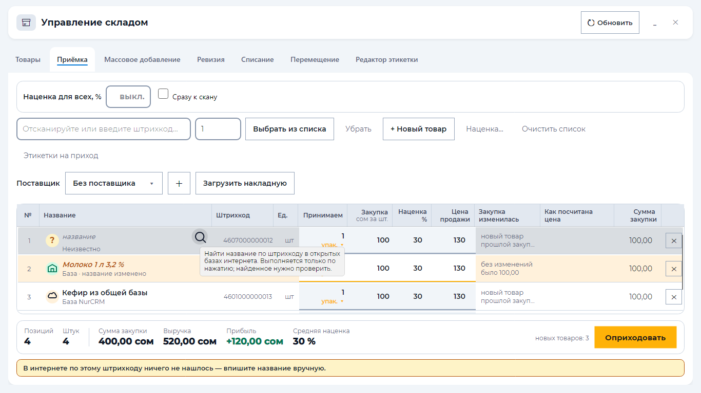

- **Было:** значки источника и правка названия появились в 1.17.84; до этого происхождение товара в строке не показывалось.
- **Стало (1.17.85 добавляет защиту названия):** слева в строке значок источника — «База» (товар кассы), «База NurCRM» (общая база), «Неизвестно» (`?`), «Из интернета». Название правится прямо в строке; если изменили — подпись «название изменено». У неизвестного штрихкода есть кнопка-лупа «Найти название по штрихкоду в открытых базах интернета» — работает **только по нажатию**, найденное нужно проверить (на снимке внизу жёлтая полоса, если в интернете ничего нет). Пустое название не принимается: «Название не может быть пустым — вернули прежнее» (снимок 02, (1.17.85)).
- **Где найти:** «Склад → Приёмка» (01) и «Закупки → Приём товара» (02). Кыргызский вид — снимок 08.
- **Проверить за 30 секунд:** отсканируйте неизвестный код → появится строка `?` с лупой; впишите название; нажмите лупу.

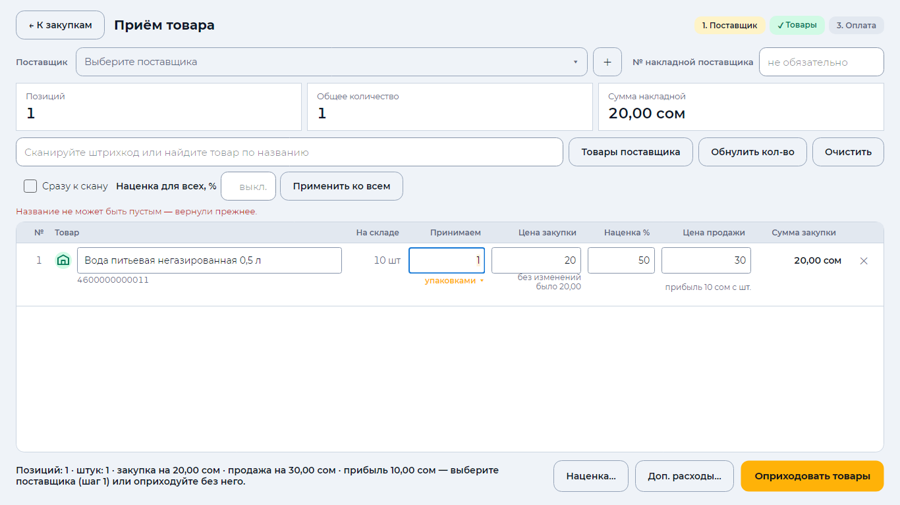

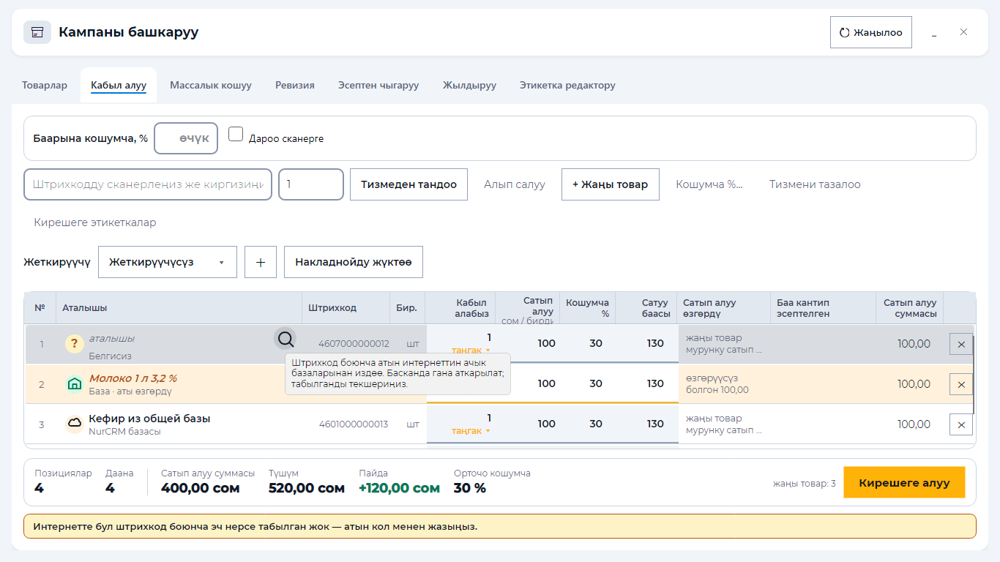

### 1.2. Новый товар: видимое поле названия и штрихкод (картинка 03)

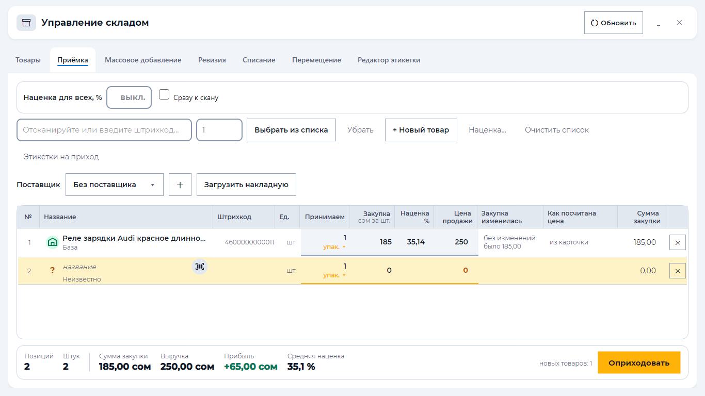

- **Было:** у новой строки `?` поле названия почти не оставляло места, текст не был виден (жалоба клиента, отчёт «Новый товар в приёмке»); кнопки «создать штрихкод» у строки не было.
- **Стало (1.17.85):** на снимке вторая строка — новый товар: серое «название» в ячейке подсвечено, рядом кнопка-штрихкод — «Сгенерировать штрихкод» (EAN-13, тот же генератор, что в окне товара; не повторяет коды каталога и других строк приёмки). Колонка «Название» шире (проверка в тесте: не уже 300 px на 1366×768 и 220 px на 1024×600).
- **Где найти:** «Склад → Приёмка», «+ Новый товар» или скан неизвестного кода.
- **Проверить:** создайте новый товар и нажмите значок штрихкода в строке — штрихкод появится в колонке «Штрихкод».

### 1.3. Приём упаковками (картинки 04, 05)

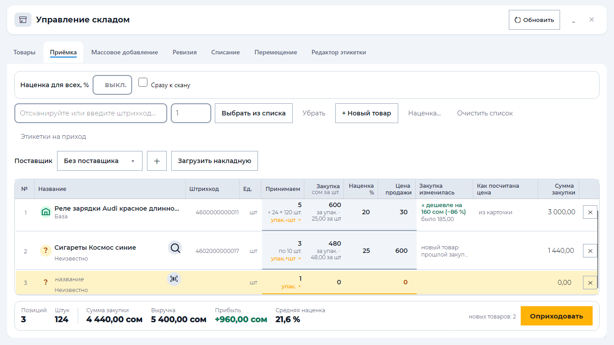

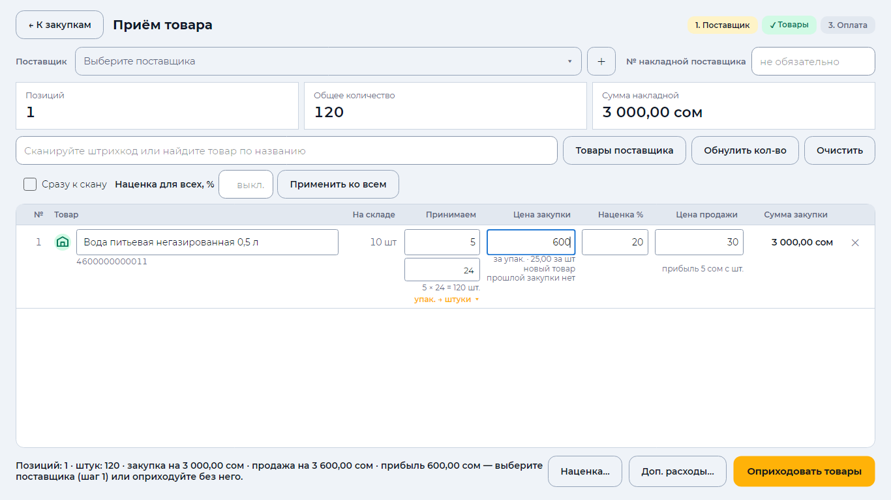

- **Было:** упаковки в приёмке появились в 1.17.82. **Стало (1.17.85):** товар склада тоже можно принять упаковкой (с подтверждением записи упаковки в карточку); в ячейке «Принимаем» есть выбор «упак.» / «упак.+шт» / «шт»; при «упак.+шт» вторая ячейка — штук в упаковке, под ними расчёт «5 × 24 = 120 шт.»; закупка считается за упаковку и за штуку («600 за упак. · 25 за шт»). Итоги внизу (Штук, Сумма закупки, Выручка, Прибыль) пересчитываются.
- **Где найти:** «Склад → Приёмка» (04) и «Закупки → Приём товара» (05), выпадающий список под числом в «Принимаем».
- **Проверить:** выберите «упак.+шт», впишите 5 и 24 — внизу «Штук 120».

### 1.4. Повторный скан — «Сколько штук?» (картинка 06)

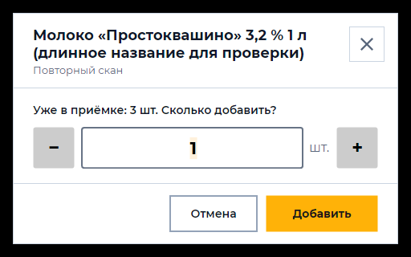

- **Было:** тот же штрихкод, отсканированный второй раз подряд, молча прибавлял +1 (жалоба: коробку «Ак Кант» подносят несколько раз, а количество не то).
- **Стало (1.17.85):** программа останавливается и спрашивает «Уже в приёмке: 3 шт. Сколько добавить?» с кнопками «−/+», «Отмена», «Добавить». Включается и выключается в настройках (см. 5.2).
- **Где найти:** оба окна приёмки.
- **Проверить:** отсканируйте один товар два раза подряд.

### 1.5. Неоконченная приёмка не пропадает (картинка 07)

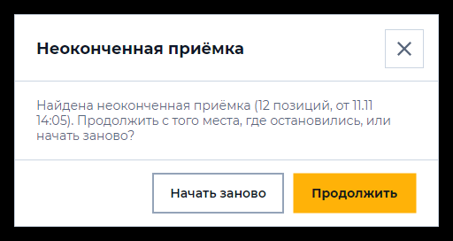

- **Было:** по жалобам клиентов неоконченная приёмка пропадала.
- **Стало (1.17.85):** черновик сохраняется; при следующем открытии: «Найдена неоконченная приёмка (12 позиций, от 11.11 14:05). Продолжить с того места, где остановились, или начать заново?» — «Продолжить» / «Начать заново». В «Закупках» после «Продолжить» наверху жёлтая строка «Продолжаем неоконченную приёмку: N позиции» (есть в тесте, снимок `receiving-draft-purchases-ru-1024x600.png` в `%TEMP%\nurmarket-tests\ui-actual\`).
- **Где найти:** «Склад → Приёмка» и «Закупки → Приём товара».
- **Проверить:** добавьте 2 строки, закройте окно, откройте снова.

---

## 2. Возвраты

### 2.1. Окно возврата: фильтры и поиск по товару (картинка 09)

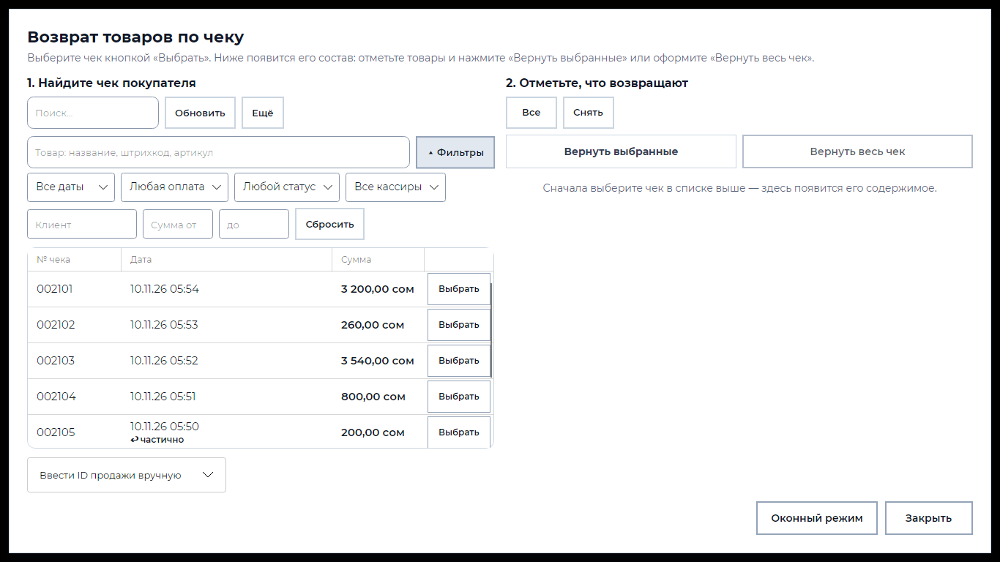

- **Было:** в окне возврата не было фильтров и поиска по товару; на возврате долгового чека красная ошибка «Есть позиции не из этого чека или несуществующие sale_item_id» (см. раздел 7).
- **Стало (1.17.85):** строка «Товар: название, штрихкод, артикул» (слова названия в любом порядке; найденная позиция в чеке сразу отмечена), кнопка «Фильтры» → даты, оплата, статус, кассир, клиент, сумма «от/до», «Сбросить». Частично возвращённые чеки помечены «↩ частично».
- **Где найти:** касса — «Возврат»; программа владельца — «Продажи → Возврат» (снимок 13).
- **Проверить:** откройте «Фильтры», выберите статус «Долг» — останутся только долговые чеки.

### 2.2. «История покупок» клиента с кнопкой «Возврат» (картинка 10)

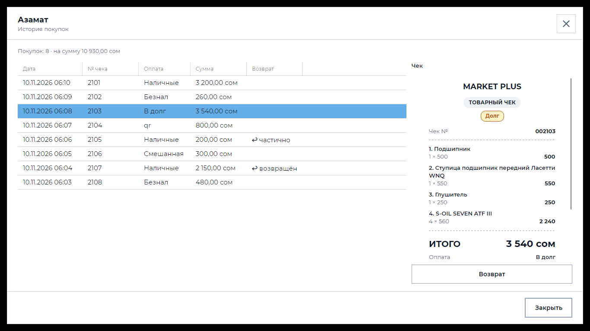

- **Стало (1.17.85):** в таблице чеков новая колонка «Возврат» («↩ частично», «↩ возвращён»); под чеком кнопка «Возврат» (у чека, возвращённого целиком, — неактивна с подсказкой). Долговой чек возвращается в счёт долга.
- **Где найти:** «Клиенты → карточка клиента → История покупок».
- **Проверить:** выберите чек — кнопка «Возврат» под ним откроет окно возврата.

### 2.3. «Долги клиентов»: «Возврат» и «WA» (картинка 11)

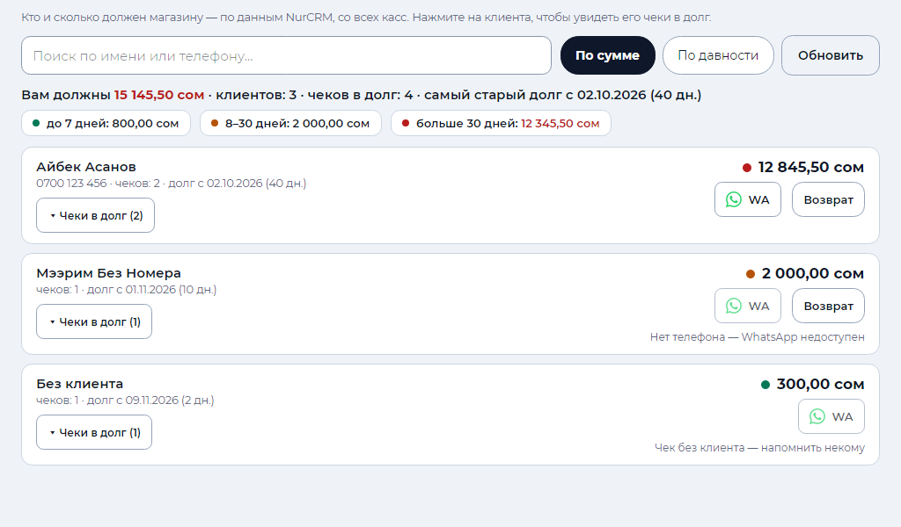

- **Стало:** кнопка «WA» у должников — из 1.17.83; **(1.17.85)** рядом добавлена «Возврат». У каждого должника справа «WA» (активна только если есть номер; иначе рядом причина: «Нет телефона — WhatsApp недоступен», «Чек без клиента — напомнить некому») и «Возврат» (по чекам клиента). 1024×600 — всё помещается.
- **Где найти:** «Долги клиентов» (в программе владельца — «Продажи → Долги клиентов»); так же кнопка «Возврат» в блоке «Долг» карточки клиента.
- **Проверить:** откройте «Долги клиентов» — у клиента с телефоном «WA» активна.

### 2.4. «Продажи»: колонка «Возврат» (картинка 12)

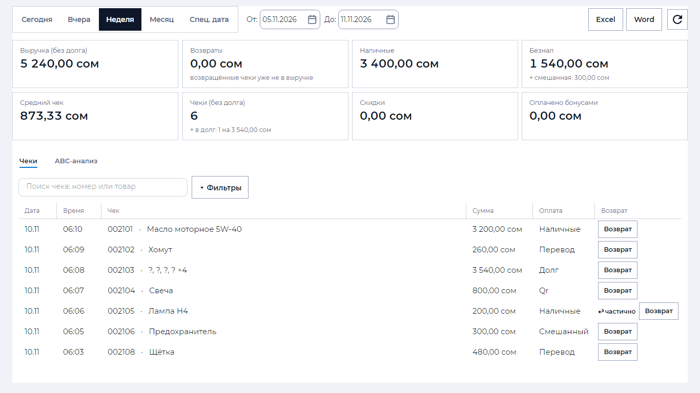

- **Стало (1.17.85):** справа в списке чеков колонка «Возврат» — кнопка «Возврат» в каждой строке, «↩ частично» у частично возвращённых; над списком — общая панель «Фильтры».
- **Где найти:** «Продажи» (касса и программа владельца), вкладка «Чеки».
- **Проверить:** нажмите «Возврат» в строке — откроется то же окно возврата, что на снимке 09. (Строка 002103 на снимке показывает «?, ?, ?, ? ×4» только потому, что у тестовой заглушки нет названий позиций.)

### 2.5. Меню программы владельца: «Возврат» (картинка 13)

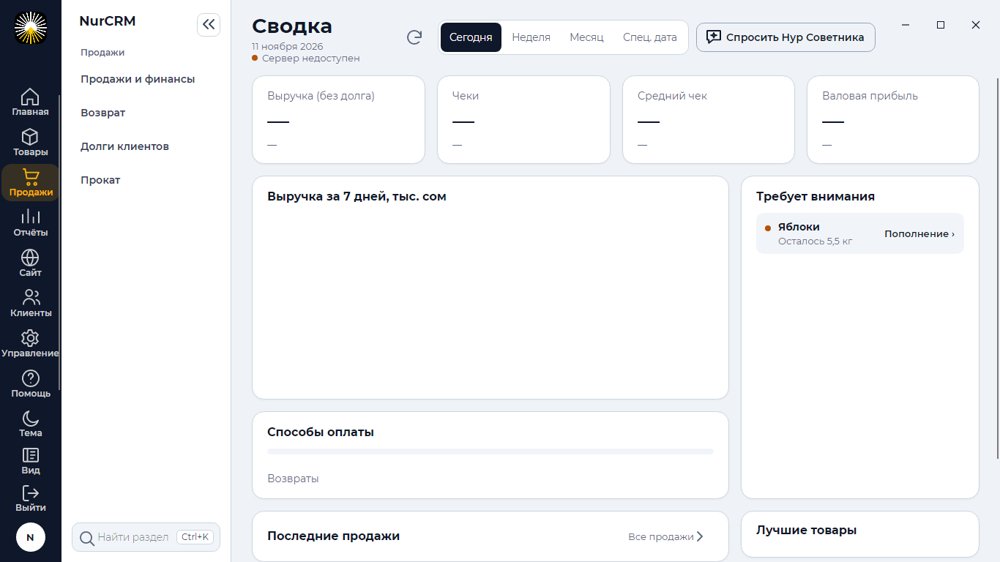

- **Стало (1.17.85):** в группе «Продажи» новый пункт «Возврат» (между «Продажи и финансы» и «Долги клиентов»). Виден при праве «Возврат» (у владельца всегда); скрыть можно в «Разделах меню».
- **Проверить:** «Продажи → Возврат».

---

## 3. Склад и штрихкоды

Отдельных экранов нет, смотрите 01–03. Что изменилось в коде и подтверждено тестами/разбором:

- **Штрихкод, поправленный в программе владельца, доходит до кассы.** Раньше кассе приходила лента изменений без штрихкода: поправили только штрихкод — касса держала старый до 2,5 минут, а то и до суток. Теперь касса сверяет карточку товара по id (отчёт: `Штрихкод — касса и программа владельца расходятся — разбор.md`, причина П1).
- **Скан штучных кодов «20…» и «27…»** в приёмке больше не принимается за весовую этикетку (раньше такой код разбирался как весы, и приёмка подставляла чужой весовой товар). Весовой этикеткой считается только код с префиксом, настроенным у магазина («Настройки → Весы»).
- **Ячейки цены защищены:** пределы цен сервера учитываются (жалоба клиента: цена продажи ≈ 5,64·10¹² сом, «похоже на штрихкод в ячейке» — причина в отчёте названа гипотезой).
- **Запросы приёмки учитывают филиал;** если штрихкод неоднозначный — касса просит выбрать товар.

---

## 4. Люди и смены (табель, рабочее время)

### 4.1. Пункт «Табель» в меню владельца (картинка 14)

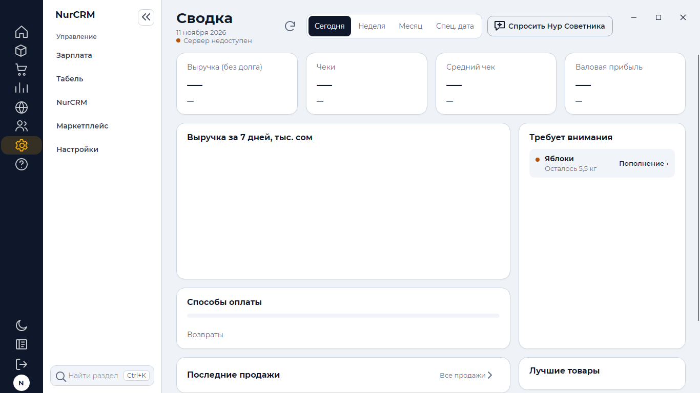

- **Стало (1.17.83):** в группе «Управление» — «Табель» (после «Зарплаты»); владельцу доступен всегда, без покупки функции.

### 4.2. Табель — сетка отметок (картинка 15)

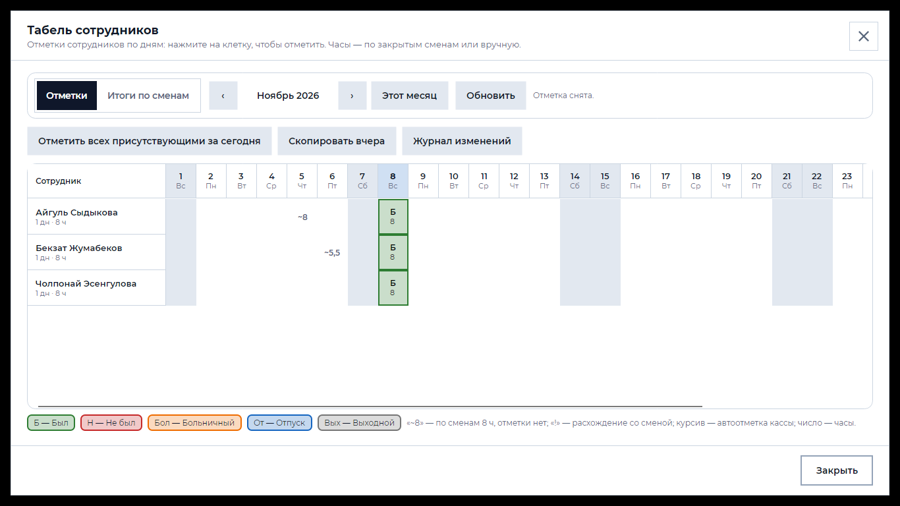

- **Стало (1.17.83):** таблица «сотрудники × дни месяца»: кнопки «Б — Был», «Н — Не был», «Бол — Больничный», «От — Отпуск», «Вых — Выходной»; число — часы; «~8» — по сменам 8 ч, отметки нет; курсив — автоотметка кассы. Кнопки «Отметить всех присутствующими за сегодня», «Скопировать вчера», «Журнал изменений»; вкладка «Итоги по сменам». На зарплату и деньги не влияет.
- **Где найти:** «Управление → Табель».
- **Проверить:** нажмите клетку сотрудника на сегодня — появится «Б».

### 4.3. Рабочее время кассира (картинка 16)

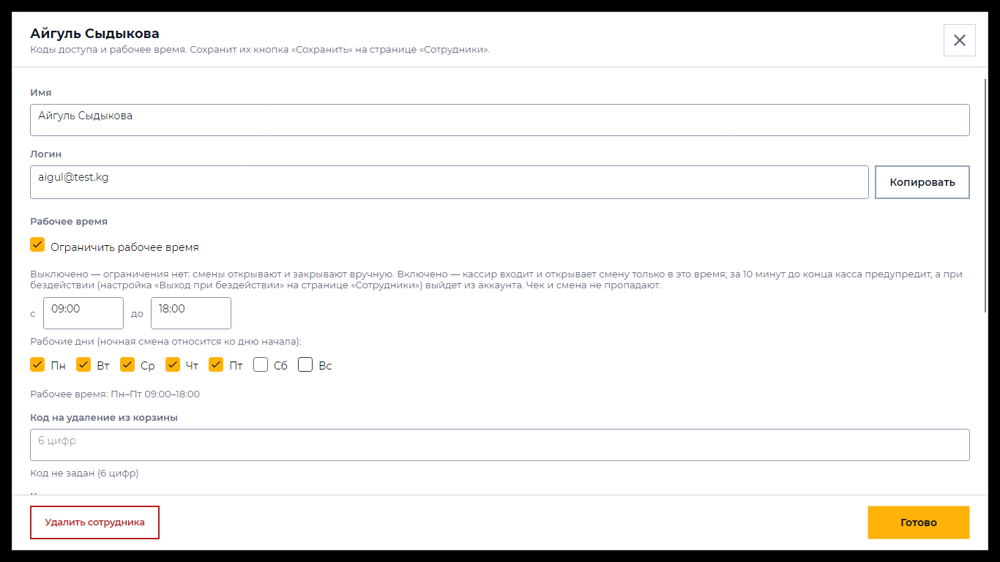

- **Стало (1.17.83):** в карточке сотрудника блок «Рабочее время»: «Ограничить рабочее время», с/до, дни недели (Пн–Вс). Включено — кассир входит и открывает смену только в это время; за 10 минут до конца касса предупреждает; при бездействии (настройка «Выход при бездействии» на странице «Сотрудники», по умолчанию 60 мин) выходит из аккаунта; чек и смена не пропадают.
- **Где найти:** «Настройки → Сотрудники → Данные» у сотрудника, затем «Сохранить» на странице «Сотрудники».
- **Проверить:** включите ограничение 09:00–18:00 — в списке сотрудников под именем появится «Рабочее время: Пн–Пт 09:00–18:00».

---

## 5. Окна

### 5.1. Затемнение вместо размытия (картинка 17)

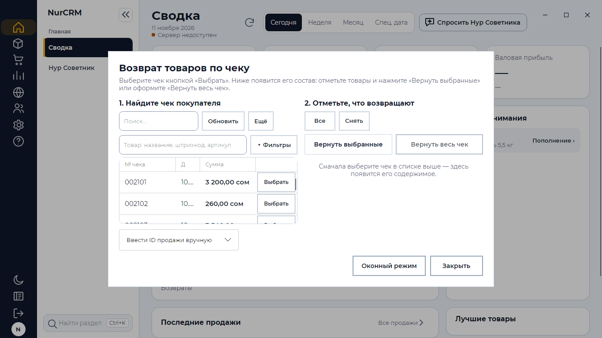

- **Было:** фон за окном размывался, затемнение появлялось после показа окна и нарастало 140 мс (по комментарию теста).
- **Стало (1.17.85):** окно владельца затемняется сразу, до построения тяжёлого окна, без размытия (тест проверяет, что у фона нет эффекта размытия, а затемнение закрывает его от нажатий). Окна можно **свернуть** — кнопка «–» в шапке окон (видна на снимках 01, 03, 04).
- **Проверить:** откройте «Возврат» в программе владельца — фон просто тёмный, без мыла.

---

## 6. Настройки и сервисы

### 6.1. Сфера магазина под замком и автоотметка (картинка 18)

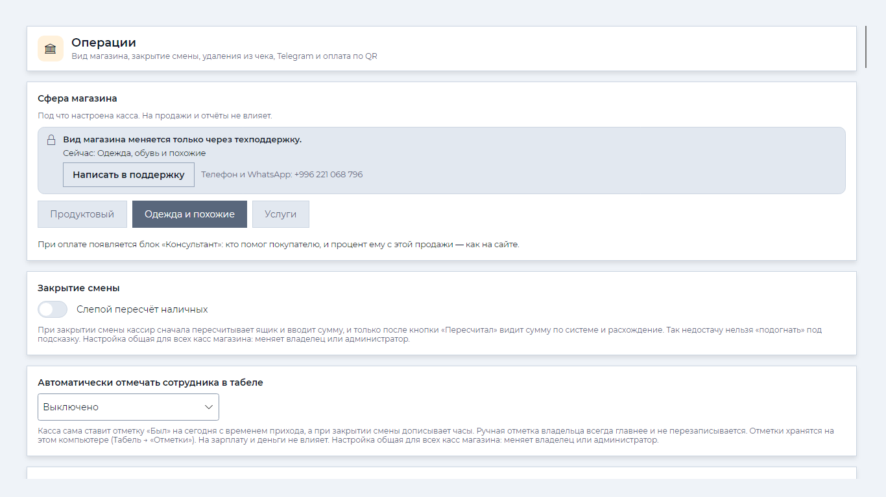

- **Стало (1.17.83):** «Вид магазина меняется только через техподдержку», кнопки видов серые, показан текущий вид, «Написать в поддержку» и телефон. Ниже — «Автоматически отмечать сотрудника в табеле» (по умолчанию «Выключено»): касса сама ставит «Был» с временем прихода и дописывает часы при закрытии смены; ручная отметка владельца главнее.
- **Где найти:** «Настройки → Операции».

### 6.2. Повторный скан в приёмке (картинка 19)

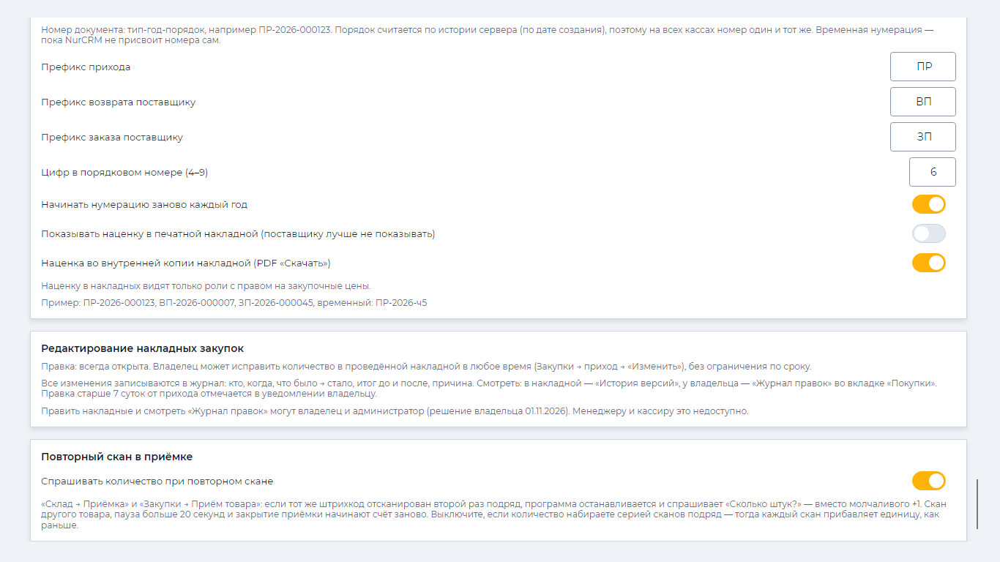

- **Стало (1.17.85):** переключатель «Спрашивать количество при повторном скане» (по умолчанию включён) — общий для «Склад → Приёмка» и «Закупки → Приём товара». Выключите, если набираете количество серией сканов подряд.
- **Где найти:** «Настройки → Операции», самая нижняя карточка.

### 6.3. «Скорость связи» и тариф «Своё» (картинки 20, 21)

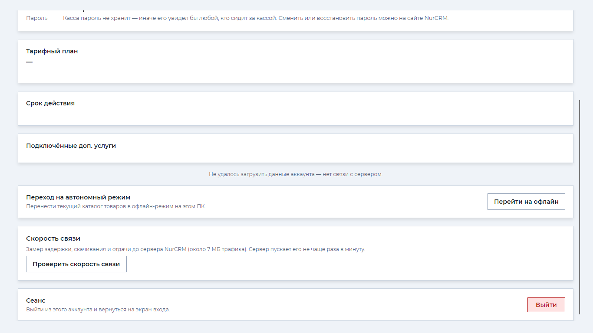

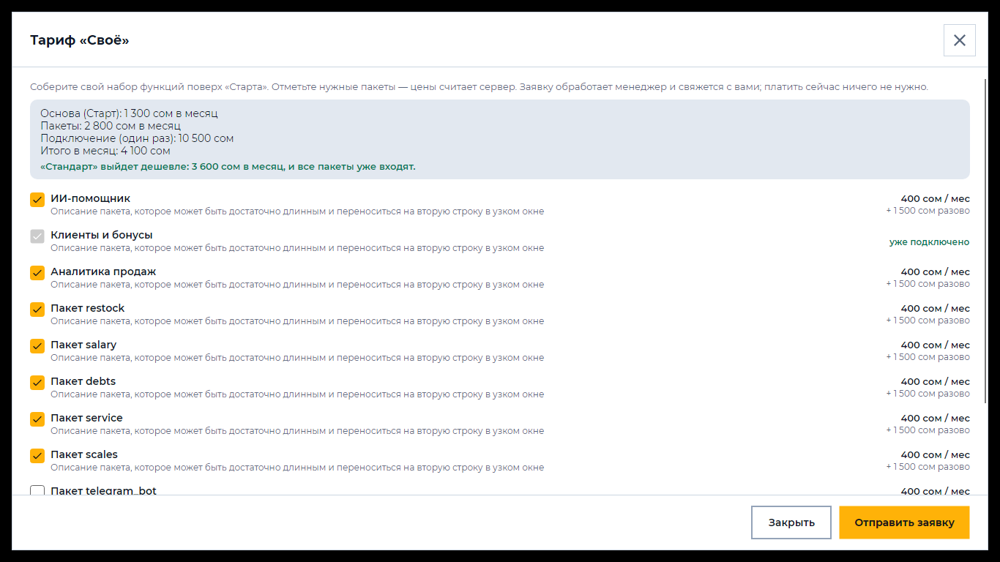

- **Стало (1.17.83):** карточка «Скорость связи» — кнопка «Проверить скорость связи» (замер задержки, скачивания и отдачи до сервера, около 7 МБ; сервер пускает не чаще раза в минуту). Карточка «Тариф «Своё»» (только владелец, в программе владельца): окно с пакетами и ценами с сервера, итог в месяц, подсказка «Стандарт выйдет дешевле», кнопка «Отправить заявку» (платить сразу ничего не нужно).
- **Где найти:** «Настройки → Аккаунт».
- **Проверить:** нажмите «Проверить скорость связи».

### 6.4. Согласия клиента и «Журнал сообщений» (картинки 22, 23)

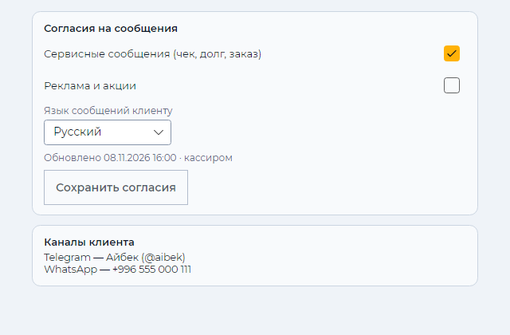

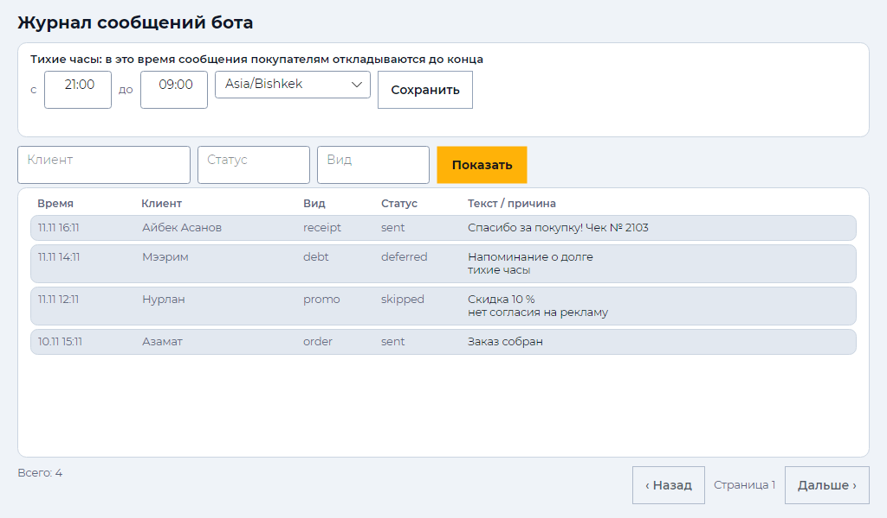

- **Стало (1.17.83):** в карточке клиента блок «Согласия на сообщения»: «Сервисные сообщения (чек, долг, заказ)», «Реклама и акции», язык сообщений, кто и когда обновил; «Каналы клиента» (Telegram, WhatsApp). «Журнал сообщений бота»: «Тихие часы» (по умолчанию 21:00–09:00, Asia/Bishkek) и таблица отправленных / отложенных / пропущенных сообщений с причиной. На снимке 22 блок показан отдельно от окна клиента; строки журнала на снимке 23 — тестовые.
- **Где найти:** «Клиенты → карточка клиента»; журнал — кнопка в разделе «Телеграм-бот» программы владельца.

### 6.5. Витрина: «Отзывы» и «Коллекции» (картинки 24, 25)

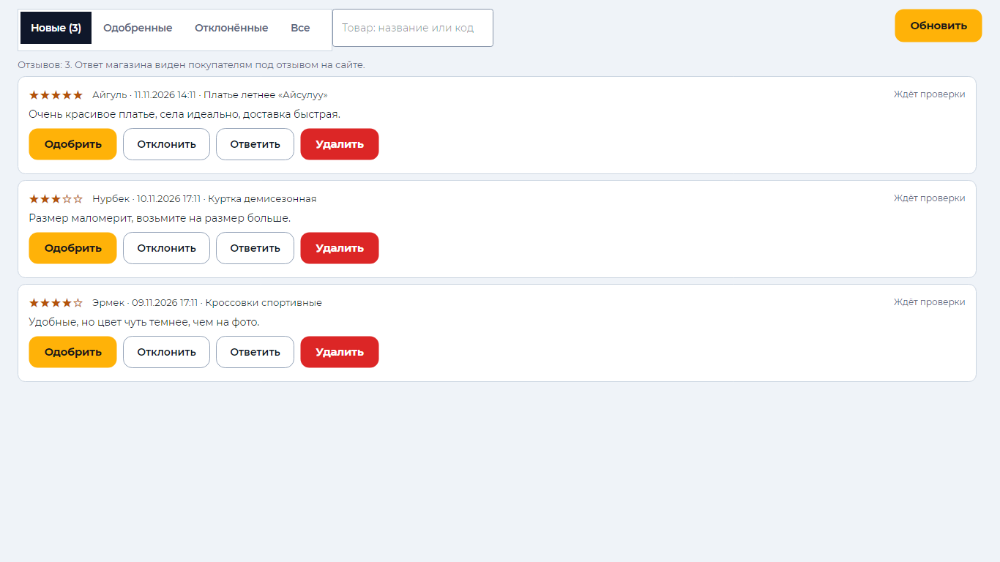

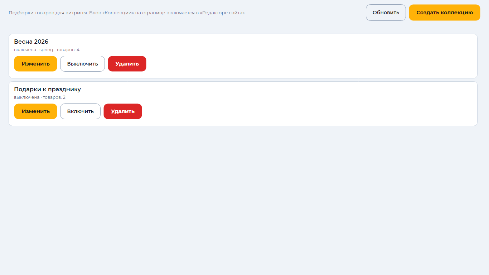

- **Стало (1.17.83):** «Отзывы» — модерация отзывов покупателей: «Новые / Одобренные / Отклонённые / Все», поиск по товару, «Одобрить», «Отклонить», «Ответить» (ответ виден на сайте), «Удалить». «Коллекции» — подборки товаров для витрины («Весна 2026»): «Изменить», «Выключить», «Удалить», «Создать коллекцию».
- **Где найти:** программа владельца, группа «Сайт». Пункты видны только если подключена услуга «Онлайн витрина».
- **Данные на снимках подставлены вручную** (отзывы и коллекции придуманы): настоящий сервер для этих разделов ещё отвечает «пока не поддерживает», как показывает пустой снимок в наборе эталонов.

---

## 7. Что я исправил по жалобам клиентов

Источник — папка клиентов «Баги клиентов десктоп мобилка» (10–11.11.2026), разбор в отчётах ниже. Все правки — в рабочей копии, не выложены и **вживую не проверены**; тесты автоматически проходят.

| Жалоба | Что было | Что стало | Где подтверждено |
|---|---|---|---|
| «Принимаем 0» в «Закупки → Приём товара» (1.17.82–1.17.84): позиций 0, итог «Сканируйте товары» | Скрытое поле «шт в упак.» (пустое) после отрисовки обнуляло количество каждой строки; «Наценка %» и «Цена продажи» при вводе портили цену | Количество, наценка и цены не меняются сами: строка скана (+1) и строка заказа (5) — «Позиций: 2 · штук: 6» | Тест `PurchasesReceive_ScanLineAndOrderLine_KeepQuantities_TotalsAndSalePrice` (`NurMarketKassa.UiTests/Screens/ReceivingCellInputUiTests.cs`); снимок 02; `release-notes-1.17.85.md` |
| Штучные коды «2x…» (в т.ч. «20…», «27…») показывались как весовые, подставлялся чужой товар («Вафли Енсо вес», «Рола Макарон» при скане банки) | Любой код на 20–29 с верной контрольной цифрой читался как этикетка весов; «товар» внутри совпадал с PLU чужого весового | Весовой считается только код с префиксом, настроенным у магазина («Настройки → Весы»); весы не настроены — код обычный | Комментарий и код `ProductCodeLookup.cs` (2026-11-11); `Баги клиентов 11.11.2026 — ТЗ.md`, Б-3 |
| Возврат долгового чека: «Есть позиции не из этого чека или несуществующие sale_item_id» | Касса выбирала id строки чека из нескольких полей (`cart_item_id, line_id, item_id …`) раньше `sale_item_id`; если сервер присылал оба — уходил не тот (причина подтверждена по коду, как именно сломалось у клиента — гипотеза) | `sale_item_id` берётся первым, после отказа — `id`; свежий чек сверяется до отправки; отказ сервера даёт понятный текст и запись в журнале; добавлены фильтры и поиск по товару | `Баги клиентов 11.11.2026 — ТЗ.md`, Б-1; тесты `ReturnLineCheckTests`, `ReturnDialog_FiltersCombine_Reset_ProductSearch_PreselectsFoundLine`; снимок 09 |
| Приёмка пропадает при закрытии или сбое | Недоделанная приёмка терялась | Сохраняется черновик, при открытии вопрос «Продолжить / Начать заново» | `ReceivingDraftUiTests.cs`; снимок 07 |
| Штрихкод в кассе не совпадает со штрихкодом в программе владельца | Лента изменений не несёт штрихкод: поправили только штрихкод — касса держала старый до 2,5 мин (иногда до суток) | Касса сверяет карточку товара по id; тест «штрихкод, изменённый у владельца, доходит до кассы по чтению карточки, а не через сутки» | `Штрихкод — касса и программа владельца расходятся — разбор.md`, П1 (исправлено). П2 (на сервере у товара нет штрихкода, касса показывает код товара) не менялось — нужно решение владельца; П3 — гипотеза, нужен ответ Умара |
| Новый товар в приёмке: поле названия пустое, ввод не виден (видео 11.34.58) | Поле названия в узком виде почти не оставляло места | Колонка «Название» не уже 300 px (1366×768) и 220 px (1024×600), название правится в ячейке, пустое название не принимается; кнопка «Сгенерировать штрихкод» у нового товара | `Новый товар в приёмке — удобство (видео 11.34.58) — ТЗ.md`; тест `WarehouseReceiving_SingleClickEditsWithSelection_…_GenerateBarcode`; снимки 01–03 |
| Повторный скан «Ак Кант» не менял количество; цена продажи в триллионы сом | Молчаливый +1; в ячейку цены попадало число вроде штрихкода | Окно «Сколько штук?»; ячейки цены защищены, пределы цен сервера учитываются; число в ячейке выделяется при входе, пустое поле допустимо, Esc отменяет ввод | `Баги клиентов 11.11.2026 — ТЗ.md`, Б-2 и Б-4; снимок 06 |

### Не исправлено / ждёт решения

- Б-6 («прибыль остаётся от старой закупки», приёмка «В долг поставщику») — гипотеза, нужны уточнения у клиента.
- Правка и аннулирование возврата (24 ч) — в тексте выпуска «когда это поддержит сервер»: ждёт ответа Умара (`ТЗ Умару — правка и аннулирование возвратных накладных 24 ч.md`, `Возвраты — правка и аннулирование 24 ч — анализ и план.md`); в галерею не включено.
- Штрихкод, которого нет на сервере (П2) — нужно решение владельца.

---

## Что осталось проверить вручную (на тестовом аккаунте NBS)

1. «Закупки → Приём товара»: скан + заказ — «Принимаем» не 0, цена не меняется сама.
2. Возврат долгового чека: окно «Возврат» → долговой чек → одна строка → «Оформить возврат» (сервер, боевой путь).
3. Поправить штрихкод в программе владельца → отсканировать новый в кассе.
4. Скан штучного кода «2…» при настроенных и ненастроенных весах.
5. Затемнение окон на реальной видеокарте (в Headless-снимке видеокарты нет).

## Связанные отчёты

- <../Баги клиентов 11.11.2026 — ТЗ.md>
- <../Новый товар в приёмке — удобство (видео 11.34.58) — ТЗ.md>
- <../Штрихкод — касса и программа владельца расходятся — разбор.md>
- <../Закупки — удобство и дизайн — аудит и план.md>
- <../Возвраты — правка и аннулирование 24 ч — анализ и план.md>
- <../ТЗ Умару — правка и аннулирование возвратных накладных 24 ч.md>
